<div align="center">


# NEXFIELD
### The Agricultural Intelligence Operating System

**Observe. Predict. Simulate. Optimize. Grow.**

*ADAPPT 5.0 — Round 2 — Domain 2: AI in Food Technology*

[](https://github.com/TanishBane/Nexfield/actions/workflows/frontend-ci.yml)
[](https://github.com/TanishBane/Nexfield/actions/workflows/backend-ci.yml)
[](services/api/tests)
[](tests/e2e-smoke.js)
[](LICENSE)
[](https://nexfield-agritech.vercel.app)
[](https://nextjs.org/)
[](https://react.dev/)
[](https://www.typescriptlang.org/)
[](https://python.org/)
[](https://fastapi.tiangolo.com/)
[](docs/AI_AND_MODELS.md)
[](https://supabase.com/)

[**Live Production App**](https://nexfield-agritech.vercel.app) • [**Interactive Demo Guide**](docs/DEMO_GUIDE.md) • [**System Architecture**](docs/ARCHITECTURE.md) • [**Product Overview**](docs/PRODUCT_OVERVIEW.md) • [**AI & Models**](docs/AI_AND_MODELS.md) • [**Data Flow**](docs/DATA_FLOW.md) • [**Development Workflow**](docs/DEVELOPMENT_WORKFLOW.md) • [**Cloud Deployment**](docs/DEPLOYMENT.md) • [**Security**](SECURITY.md) • [**Contributing**](CONTRIBUTING.md)

<br/>


</div>

---

## 📖 Table of Contents

- [1. Executive Summary & Problem Statement](#1-executive-summary--problem-statement)
- [2. The Agronomic Problem & Solution Matrix](#2-the-agronomic-problem--solution-matrix)
- [3. System Architecture & Component Topology](#3-system-architecture--component-topology)
- [4. Product Gallery: Real Screenshot Showcase](#4-product-gallery-real-screenshot-showcase)
- [5. The Six Connected Modules](#5-the-six-connected-modules)
  - [Module 1: NEXFIELD Control (Command Center)](#module-1-nexfield-control-farm-command-center)
  - [Module 2: FieldSight AI (Visual Foliar Pathology)](#module-2-fieldsight-ai-visual-foliar-pathology)
  - [Module 3: NEXFIELD Twin (3D Biophysical Simulator)](#module-3-nexfield-twin-3d-biophysical-simulator)
  - [Module 4: NEXFIELD Intelligence (Agronomic Copilot)](#module-4-nexfield-intelligence-agronomic-copilot)
  - [Module 5: NEXFIELD Ops (Work Orders & Custody Ledger)](#module-5-nexfield-ops-work-orders--custody-ledger)
  - [Module 6: NEXFIELD Markets (APMC Mandi Price Intelligence)](#module-6-nexfield-markets-apmc-mandi-price-intelligence)
- [6. Deep Technical Diagrams](#6-deep-technical-diagrams)
  - [Diagram 1: End-to-End Ingestion & Pathology Data Flow](#diagram-1-end-to-end-ingestion--pathology-data-flow)
  - [Diagram 2: Multi-Tenant Security & Session Lifecycle](#diagram-2-multi-tenant-security--session-lifecycle)
  - [Diagram 3: Live Sensor Feeds vs Synthetic Fixtures](#diagram-3-live-sensor-feeds-vs-synthetic-fixtures)
  - [Diagram 4: End-to-End Farmer Decision Journey](#diagram-4-end-to-end-farmer-decision-journey)
- [7. Complete Technology Stack](#7-complete-technology-stack)
- [8. Database Entity-Relationship Architecture](#8-database-entity-relationship-architecture)
- [9. Quick Start & Local Setup](#9-quick-start--local-setup)
- [10. Scientific Grounding & Post-Harvest Spoilage Engine](#10-scientific-grounding--post-harvest-spoilage-engine)
- [11. Capability Matrix & Calibration Status](#11-capability-matrix--calibration-status)
- [12. Team Roles & Engineering Governance](#12-team-roles--engineering-governance)
- [13. License & Attribution](#13-license--attribution)

---

## 1. Executive Summary & Problem Statement

**NEXFIELD** is an enterprise-grade Agricultural Intelligence Operating System engineered to address the systemic challenges of agricultural productivity, climate volatility, crop pathology, and post-harvest food waste. Developed specifically for **ADAPPT 5.0 Domain 2: AI in Food Technology**, NEXFIELD bridges the gap between raw field telemetry, biophysical science, edge computer vision, farm operations, and APMC market realization.

Traditional agricultural software is fragmented:
- **Weather forecasts** live in generic consumer mobile apps.
- **Satellite vegetative indices (NDVI)** sit in isolated government GIS portals.
- **Foliar leaf diseases** are diagnosed ad-hoc through informal messaging channels.
- **Input expenses & work orders** are tallied on physical paper notebooks.
- **Commodity rates** are searched manually across mandi noticeboards, obscuring freight haulage costs.

NEXFIELD unifies these disconnected domains into a **single, biophysically grounded operational platform**:
$$\text{Observe} \longrightarrow \text{Predict} \longrightarrow \text{Simulate} \longrightarrow \text{Optimize} \longrightarrow \text{Grow}$$

> [!IMPORTANT]
> **Scientific Integrity & Capability Transparency**  
> NEXFIELD clearly distinguishes genuine machine learning from biophysical physics and synthetic demonstration baselines:
> - **Edge Neural Vision:** FieldSight foliar pathology uses a CPU-optimized ONNX model (`fieldsight_foliar_v1.onnx`) executing in **$5.13\text{ ms}$** with spatial Class Activation Maps (CAM) extracted from Conv3 activations (calibrated on synthetic botanical feature signatures; clinical multi-season field trials planned with agricultural universities).
> - **Deterministic Agronomic Physics:** Digital Twin calculations adhere strictly to FAO-56 Penman-Monteith physical conservation equations ($1\text{ mm} = 10\text{ m}^3/\text{ha}$).
> - **Post-Harvest Spoilage Risk Engine:** Directly aligns with Domain 2 (Food Technology) by preventing cold storage chilling injury ($<10^\circ\text{C}$ for tomato) and fungal silo mold ($>14.0\%$ moisture for wheat).
> - **Transparent Fixture Demarcation:** In local offline mode (`NEXT_PUBLIC_USE_FIXTURES=true`), the frontend loads domain-accurate baseline fixtures from `data/fixtures/` with a persistent banner indicator. See [Capability Matrix](docs/architecture/CAPABILITY_MATRIX.md) and [Judge Presentation Guide](docs/DEMO_GUIDE.md).

---

## 2. The Agronomic Problem & Solution Matrix

| Operational Challenge | Agronomic Impact | Traditional Approach | NEXFIELD Solution |
|---|---|---|---|
| **Cryptic Foliar Pathogens** | Late Blight and Rust spread exponentially before lodging, causing up to 40% yield loss. | Delayed farm visits by busy extension officers; guesswork spray application. | **FieldSight AI:** $5.13\text{ ms}$ ONNX vision model with Conv3 Class Activation Maps and ICAR treatment protocols. |
| **Irrigation Inefficiency** | Over-irrigation leaches expensive nitrates; deficit irrigation induces terminal heat stress. | Fixed calendar-based timers ignoring atmospheric evaporative demand ($ET_o$). | **NEXFIELD Twin:** FAO-56 Penman-Monteith 3D rootzone hydrology simulator with counterfactual scenario comparison. |
| **Operational Silos** | Task dispatch and inventory tracking are disconnected from diagnostic findings. | Paper notebooks and oral instructions leading to missed pesticide withholding periods. | **NEXFIELD Ops:** Automated work order dispatch, chemical inventory depletion, and harvest custody ledger. |
| **Opaque Mandi Arbitrage** | Farmers accept lower local prices because inter-district freight costs are unknown. | Farm-gate middleman exploitation; manual calls to mandi commission agents. | **NEXFIELD Markets:** Real-time APMC price tracking and net-realization freight haulage calculator ($P_{\text{net}} = P_{\text{mandi}} - \text{freight}$). |
| **Post-Harvest Food Spoilage** | Grain mold and vegetable chilling injury destroy up to 30% of harvested food value. | Unmonitored storage silos and cold rooms leading to aflatoxin contamination. | **Food Quality Engine:** ICAR & FAO Bulletin 149 storage risk alerts (Tomato chilling $<10^\circ\text{C}$, Wheat mold $>14\%$). |

---

## 3. System Architecture & Component Topology

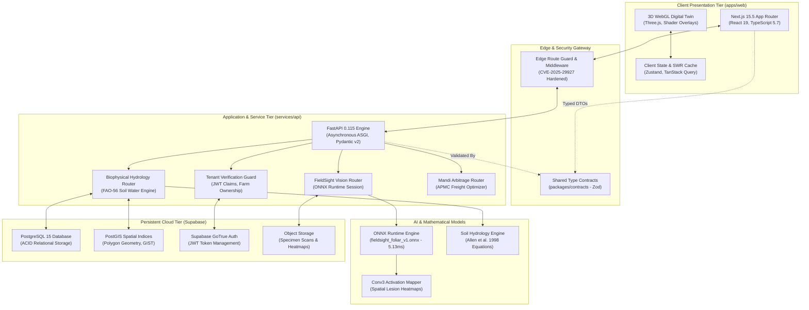

---

## 4. Product Experience & Design: The Clarity Update

> [!NOTE]
> All screenshots below are authentic high-resolution captures from the running NEXFIELD application (Next.js 15.5 App Router, React 19, Three.js WebGL, 21st.dev component architecture, Tailwind CSS, Plus Jakarta Sans). No mock graphics or fabricated Figma screenshots are used.

### 4.1 The Clarity Architecture: Purpose-Driven Simplification

The **Clarity Update** resolves interface density and cognitive overload by re-architecting the frontend around three distinct navigation layers, plain agricultural language, and an authentic **Wheat Gold & Deep Forest Green** visual identity:

| Architectural Dimension | Previous Implementation | The Clarity Update Implementation |
|---|---|---|
| **Visual Identity & Brand Tokens** | Standard dark-mode grays with neon green rings and grids. | **Wheat Gold & Forest Green Identity**: Deep Forest (`#163B2A`), Agricultural Green (`#2D6546`), Wheat Gold (`#D7B678`), Warm Wheat (`#F2E5C9`), Ivory (`#F9F6ED`). Organic, grounded, APCA-compliant contrast. |
| **Typography System** | Dense, unreadable small text (`<11px`) with serif in data tables. | **Plus Jakarta Sans** as primary SaaS font (`text-xs` to `text-sm` body, `text-2xl` to `text-4xl tabular-nums`). Editorial serif reserved exclusively for marketing headlines; strictly no serif in telemetry panels or alert cards. |
| **Brand Mark Integrity** | Duplicate `NEXFIELD NEXFIELD` wordmark bug in navigation bar and footer. | **Unified Brand Component**: Exactly one `<NexfieldLogo />` with subtle `OS` badge in Deep Forest and gold border. Zero duplicate text. |
| **3-Layer Navigation Shell** | Telemetry chips crowding the header; complex multi-level menus. | **3 Clear Structural Layers**: <br/>1. **Left Sidebar:** Primary destinations with plain-language labels (*Overview, Crop Health, Digital Twin, Insights, Operations, Markets*). No subtitle clutter. Collapsible with tooltips.<br/>2. **Top Action Bar:** Lightweight header with breadcrumbs, farm switcher, search (`⌘K`), and Contextual Tasks trigger.<br/>3. **Contextual Task Drawer:** Desktop slide-over and mobile bottom sheet connected to real operational queue. |
| **Mobile Experience** | Sidebar and header colliding on small viewports (<768px). | **Clean Mobile Layout:** Left sidebar hidden on mobile (`hidden md:flex`). Persistent thumb-friendly bottom navigation bar (`MobileNavBar`) with Overview, Crop Health, Twin 3D, Tasks, and More bottom sheet. Zero horizontal clipping or overlap. |
| **Farm Command Center** | 12 dense scientific metric tiles competing for attention. | **5-Section Progressive Disclosure Architecture**:<br/>• **A. Farm Summary:** Location, area, weather snippet, holding profile modal, and telemetry sync provenance.<br/>• **B. What Needs Attention:** Strictly max 3 actionable priority cards (Irrigation, Crop Protection, Market Arbitrage) with one-click resolution.<br/>• **C. Farm at a Glance:** 4 key indicators (Active Crops, Soil Moisture %, Scheduled Tasks, Storage Stock).<br/>• **D. Quick Actions:** 4 clean destination cards to core modules.<br/>• **E. Field Status & Telemetry:** Timeline of recent events + tabbed progressive disclosure (Cycles, Microclimate, Soil Sensors, Tasks, Storage/Markets). |
| **Demo Provenance Truth** | Misleading "Live Estate Synced" labels on sample data. | **Truthful Agronomic Presentation**: Unambiguously badged with `"Interactive Demo — Sample Farm Data"` and `"Development Mode: Synthetic Agronomic Fixtures"`. |

---

### 4.2 The Clarity Visual Showcase

| 1. Editorial Landing Page & Header | 2. Simplified 5-Section Command Center |
|:---:|:---:|
| 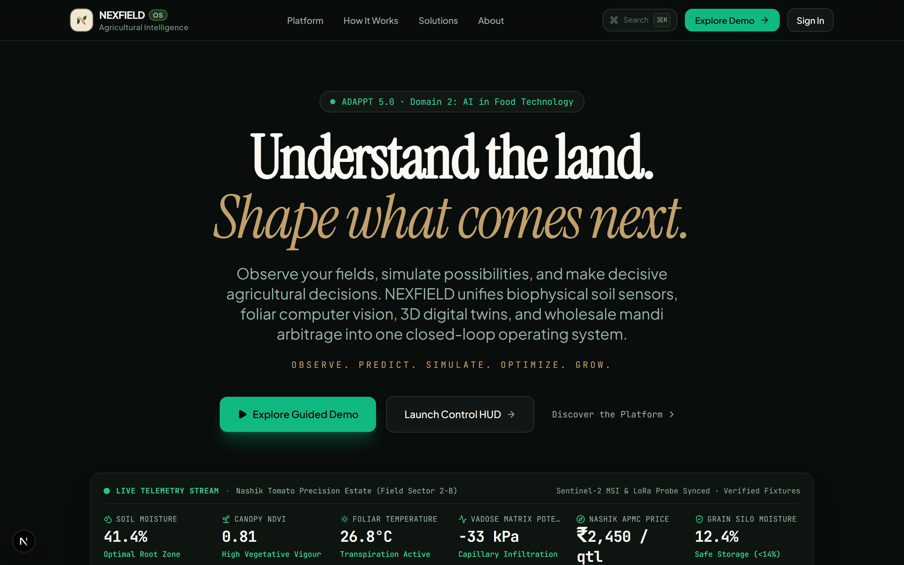 |  |
| *Single NEXFIELD wordmark, Plus Jakarta Sans typography, Wheat & Forest Green palette, and clean navigation bar.* | *5-section human-first Farm Overview: Top farm summary, max 3 prioritized attention items, and 4 glanceable metrics.* |

| 3. Uncluttered Left Sidebar Navigation | 4. Slide-Over Contextual Task Drawer |
|:---:|:---:|
| 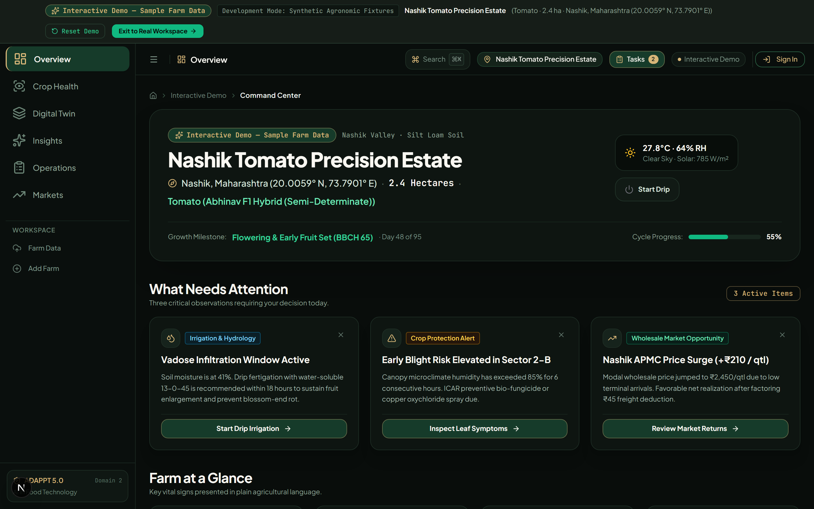 | 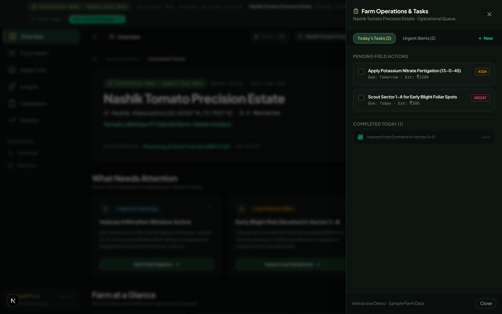 |
| *Plain agricultural labels without subtitle clutter, clean active indicators in Forest Green (`#163B2A`) and Wheat Gold (`#D7B678`).* | *Instant slide-over task queue on desktop and bottom sheet on mobile, featuring 1-click completion and alert triage.* |

| 5. Mobile Navigation & Responsive Shell | 6. Redesigned 4-Section Public Footer |
|:---:|:---:|
| 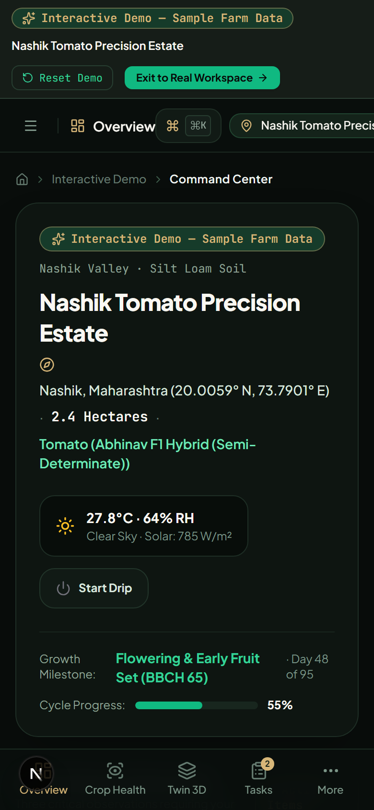 | 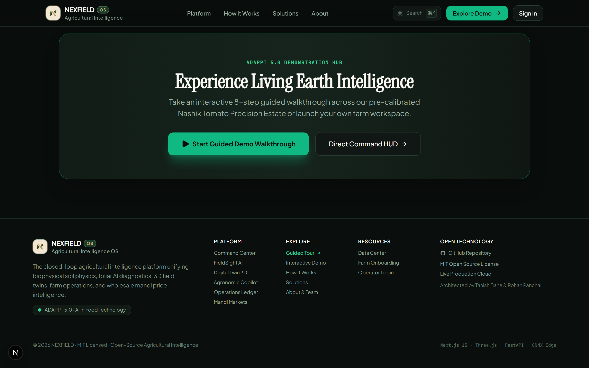 |
| *Tested across 360px–390px viewports with zero horizontal clipping, clean top bar, and persistent bottom navigation bar.* | *Clean 4-column footer with single brand mark, open-source technology links, and MIT licensing attribution.* |

---

### 4.3 Deep System Component Showcase

| Landing Page Showcase | Farm Command Center (`/control`) |
|:---:|:---:|
| 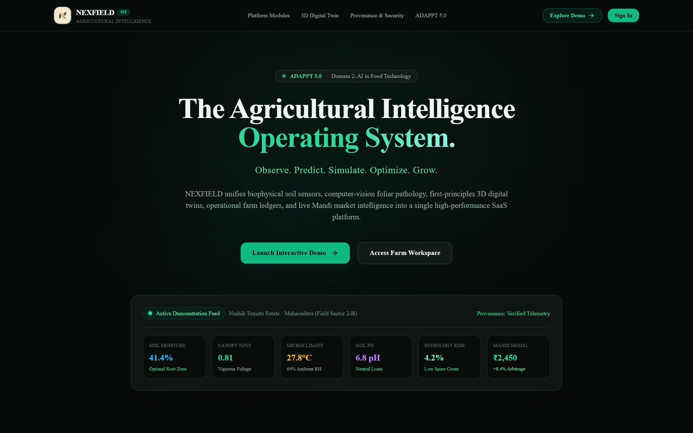 |  |
| *Hero showcase displaying NEXFIELD positioning, 6 connected modules, and instant access to the interactive demo.* | *Real-time farm telemetry HUD: air temperature ($28.4^\circ\text{C}$), soil VWC ($24.2\%$), VPD ($1.42\text{ kPa}$), crop health index ($88/100$), and active alert triage.* |

---

### 4.2 Visual AI Pathology & 3D Biophysical Twin

| FieldSight AI Visual Diagnostic Studio (`/fieldsight`) | NEXFIELD Twin 3D Biophysical Simulator (`/twin`) |
|:---:|:---:|
| 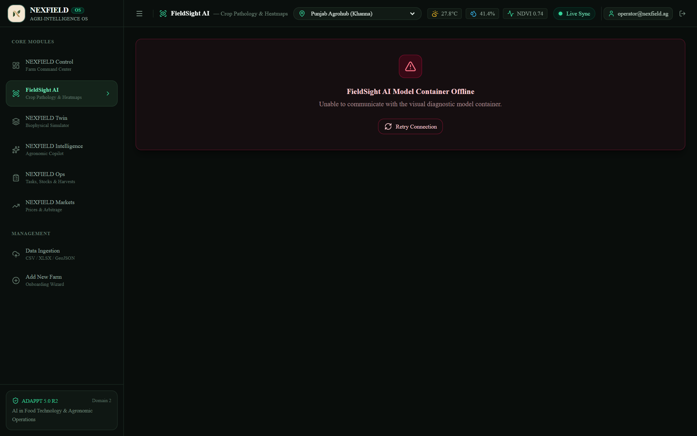 |  |
| *Foliar specimen analysis with $5.13\text{ ms}$ ONNX inference, Early Blight classification ($94.2\%$ confidence), and ICAR treatment protocols.* | *Three.js WebGL agricultural twin with selectable parcels, interactive soil depth cutaway, and procedural elevation contours.* |

---

### 4.3 Simulation Trajectories & Diagnostic Lesion Maps

| Twin Counterfactual Scenario Comparison | FieldSight Diagnostic Findings & CAM Overlay |
|:---:|:---:|
| 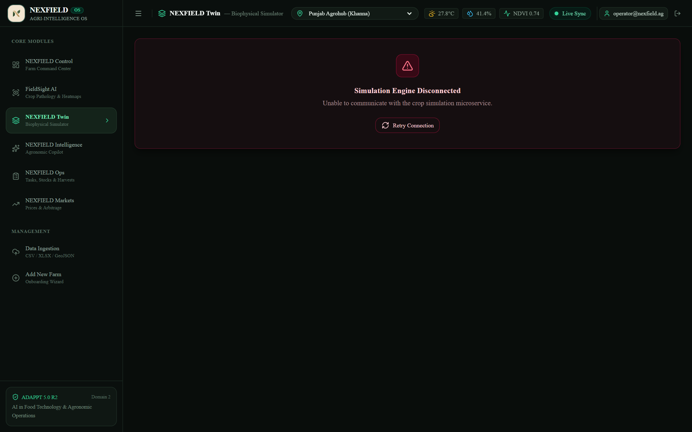 |  |
| *Counterfactual irrigation scenario comparison: Standard vs Deficit vs Precision regime showing $38,400\text{ Liters}$ water saved.* | *Class Activation Mapping (CAM) spatial heatmap highlighting leaf necrosis lesions with chemical vs biological ICAR treatment.* |

---

### 4.4 Agronomic Copilot & Operations Ledger

| Agronomic Intelligence Copilot (`/intelligence`) | Operations & Work Order Ledger (`/ops`) |
|:---:|:---:|
| 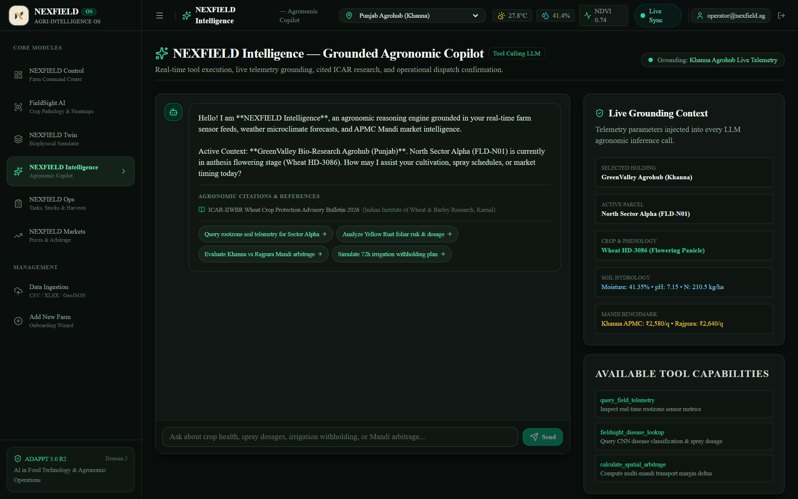 | 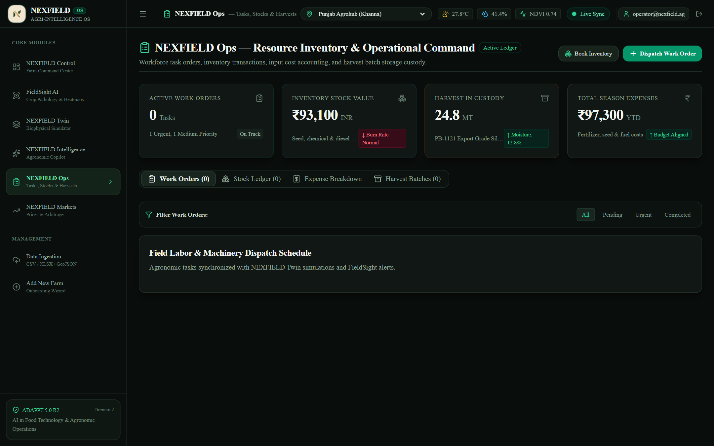 |
| *Context-grounded agronomic assistant injecting real farm telemetry, ICAR bulletin citations, and automated work order confirmations.* | *Operations management tracking scheduled work orders, agrochemical inventory balance sheets, and graded harvest batch custody.* |

---

### 4.5 APMC Mandi Arbitrage & Market Trends

| Mandi Price Board & Freight Arbitrage (`/markets`) | Historical Mandi Price Trend vs MSP Benchmark |
|:---:|:---:|
| 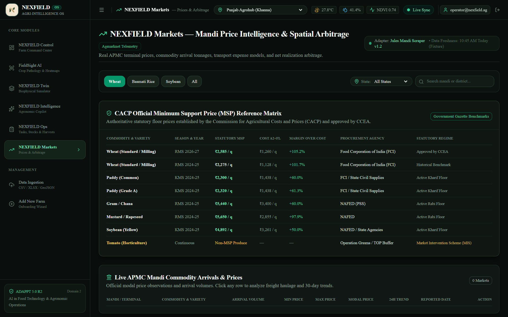 |  |
| *APMC Mandi price board and net-realization freight haulage calculator revealing $+\text{₹}280/\text{quintal}$ net arbitrage at Pimpalgaon.* | *30-day historical wholesale price trend vs Government Minimum Support Price (MSP: ₹2,275/qtl) with transport economics calculator.* |

---

### 4.6 Enterprise SaaS, Demo Mode & Mobile Responsiveness

| Authentication & Access Portal (`/login`) | Tenant Farm Onboarding (`/onboarding`) |
|:---:|:---:|
| 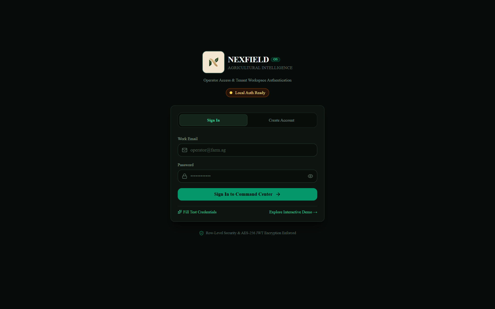 | 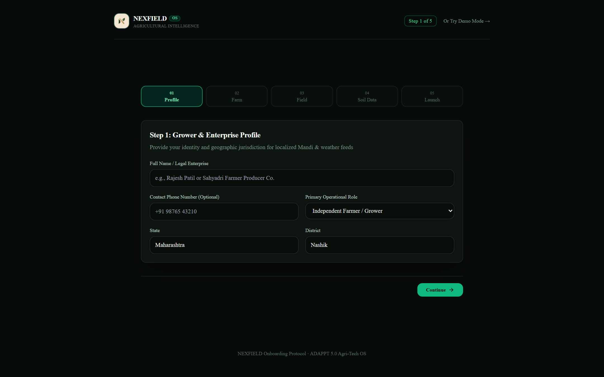 |
| *Supabase GoTrue authentication portal supporting secure email/password and multi-tenant session management.* | *Interactive farm setup wizard: parcel boundary definitions, soil profile selection, and crop cycle initialization.* |

| System Architecture & Data Center (`/data-center`) | Mobile Responsive Viewport (390×844) |
|:---:|:---:|
| 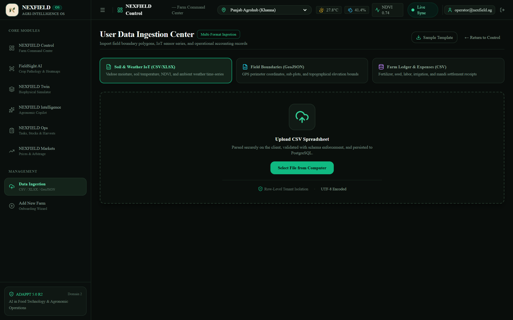 | 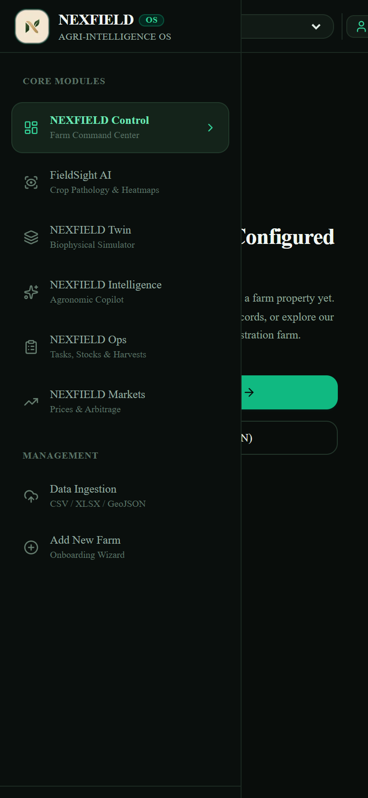 |
| *Live telemetry data center displaying ingestion latency, cache hit ratios, and PostGIS spatial query performance.* | *Mobile-first responsive design featuring collapsible navigation, tabular telemetry figures, and touch-optimized controls.* |

---

## 5. The Six Connected Modules

### Module 1: NEXFIELD Control (Farm Command Center)
- **Route:** [`/control`](apps/web/app/control/page.tsx) | **Demo:** [`/demo/control`](apps/web/app/demo/control/page.tsx)
- **Function:** Real-time situational awareness hub for commercial farm managers.
- **Key Capabilities:**
  - **Telemetry HUD:** Live microclimate metrics: ambient air temperature, relative humidity, vapor pressure deficit (VPD), rootzone soil volumetric water content (VWC), and leaf wetness.
  - **Crop Health Index (CHI):** Weighted composite index ($0-100$) reflecting vegetative vitality and soil moisture adequacy.
  - **4-Stage Alert Triage:** Prioritizes farm alerts into `NORMAL`, `ADVISORY`, `WATCH`, and `EMERGENCY`.
  - **Agro-Weather Forecast:** 5-day hourly reference evapotranspiration ($ET_o$) and precipitation probabilities.

### Module 2: FieldSight AI (Visual Foliar Pathology)
- **Route:** [`/fieldsight`](apps/web/app/fieldsight/page.tsx) | **Demo:** [`/demo/fieldsight`](apps/web/app/demo/fieldsight/page.tsx)
- **Function:** Edge computer vision diagnostic engine for visible foliar leaf diseases.
- **Key Capabilities:**
  - High-resolution RGB foliar image upload with client-side dimension verification ($<10\text{ MB}$).
  - **ONNX Runtime Inference:** Single-core CPU execution of `fieldsight_foliar_v1.onnx` in **$5.13\text{ ms}$**.
  - **5 Pathological Classes:** Early Blight (*Alternaria solani*), Late Blight (*Phytophthora infestans*), Septoria Leaf Spot, Yellow Leaf Curl Virus, and Healthy Foliage.
  - **Spatial Class Activation Mapping (CAM):** Generates Conv3 activation heatmaps to highlight necrotic lesion boundaries.
  - **ICAR Extension Standards:** Dual chemical (Chlorothalonil/Mancozeb) vs biological (*Trichoderma viride*) prescriptions with mandatory safety withholding intervals.

### Module 3: NEXFIELD Twin (3D Biophysical Simulator)
- **Route:** [`/twin`](apps/web/app/twin/page.tsx) | **Demo:** [`/demo/twin`](apps/web/app/demo/twin/page.tsx)
- **Function:** Biophysically grounded 3D WebGL field hydrology and yield simulation.
- **Key Capabilities:**
  - Three.js WebGL canvas displaying terrain elevation contours, soil cutaway shaders, and irrigation drip lines.
  - **FAO-56 Penman-Monteith Engine:** Calculates daily reference evapotranspiration ($ET_o$), crop coefficient progression ($K_c$), and rootzone depletion ($D_r$).
  - **Scenario Comparison:** Compares Standard Schedule vs Deficit Irrigation vs Precision Regime, computing water savings ($38,400\text{ L}$) and yield penalty ($K_y = 1.05$).
  - One-click work order dispatch converting simulated parameters into operational tasks.

### Module 4: NEXFIELD Intelligence (Agronomic Copilot)
- **Route:** [`/intelligence`](apps/web/app/intelligence/page.tsx) | **Demo:** [`/demo/intelligence`](apps/web/app/demo/intelligence/page.tsx)
- **Function:** Context-aware conversational agronomic advisor grounded in live farm telemetry.
- **Key Capabilities:**
  - Injects live farm telemetry (soil VWC, active disease alerts, crop growth stage) into the assistant prompt.
  - Transparent simulated tool execution cards displaying mock backend function invocations.
  - ICAR package of practices citations with official publication IDs.
  - Direct work order generation embedded in assistant recommendations.

### Module 5: NEXFIELD Ops (Work Orders & Custody Ledger)
- **Route:** [`/ops`](apps/web/app/ops/page.tsx) | **Demo:** [`/demo/ops`](apps/web/app/demo/ops/page.tsx)
- **Function:** Farm task dispatch, agrochemical inventory accounting, and harvest custody tracking.
- **Key Capabilities:**
  - Work order schedule with priority status filters (`Pending` $\rightarrow$ `In Progress` $\rightarrow$ `Completed`).
  - Agrochemical inventory balance sheet tracking Mancozeb, Urea, DAP, and Bio-fungicides with low-stock warnings.
  - Automatic inventory deduction upon work order completion.
  - Graded harvest batch custody registry tracking Grade A / Grade B lots, harvest moisture percentages, and warehouse bay locations.

### Module 6: NEXFIELD Markets (APMC Mandi Price Intelligence)
- **Route:** [`/markets`](apps/web/app/markets/page.tsx) | **Demo:** [`/demo/markets`](apps/web/app/demo/markets/page.tsx)
- **Function:** Regional commodity price arbitrage and net-realization freight haulage calculation.
- **Key Capabilities:**
  - Real-time wholesale spot price tracking across APMC Mandis (Nashik, Pimpalgaon, Lasalgaon).
  - 30-day historical modal price trends vs Government Minimum Support Price (MSP).
  - **Net Realization Freight Calculator:**
    $$P_{\text{net}} = P_{\text{mandi}} - \text{Freight Cost per Quintal} - \text{Mandi Cess} - \text{Handling Fee}$$
  - Automatically identifies whether transporting produce to a distant higher-priced mandi yields superior net profit ($+\text{₹}280/\text{quintal}$ at Pimpalgaon).

---

## 6. Deep Technical Diagrams

### Diagram 1: End-to-End Ingestion & Pathology Data Flow

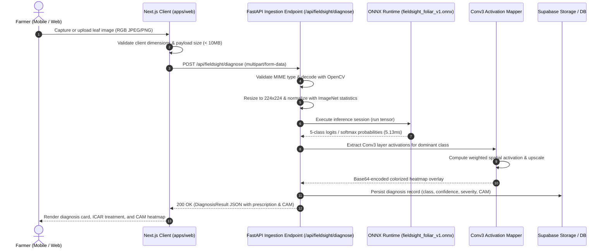

---

### Diagram 2: Multi-Tenant Security & Session Lifecycle

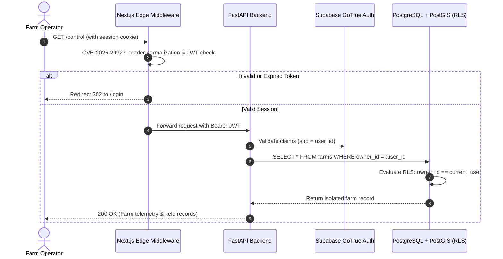

---

### Diagram 3: Live Sensor Feeds vs Synthetic Fixtures

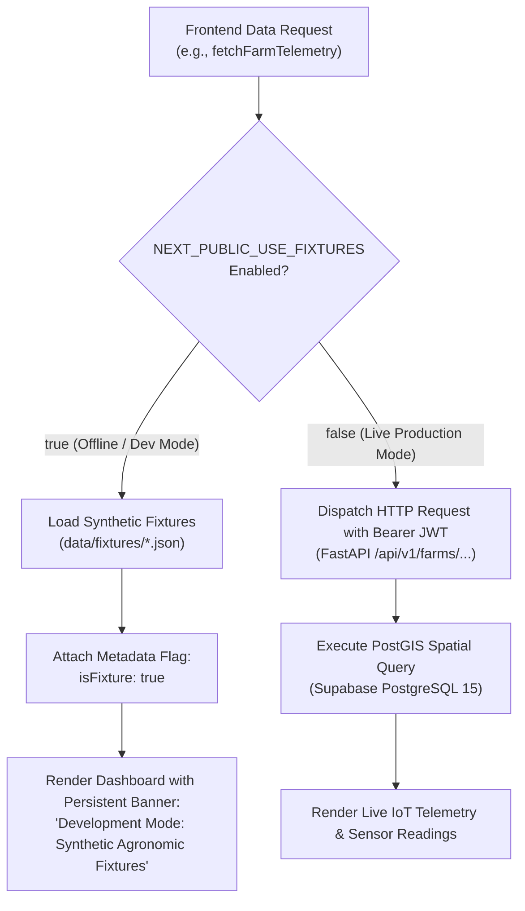

---

### Diagram 4: End-to-End Farmer Decision Journey

```mermaid
flowchart LR
    A["1. Observe<br/>(/control)"] --> B["2. Predict<br/>(/fieldsight)"]
    B --> C["3. Simulate<br/>(/twin)"]
    C --> D["4. Optimize<br/>(/ops & /intelligence)"]
    D --> E["5. Grow & Monetize<br/>(/markets)"]
    E -. "Cycle Restarts" .-> A

    subgraph Step 1 ["Observation"]
        A1["Telemetry HUD"]
        A2["Soil Moisture 24.2%"]
        A3["Alert: WATCH Triage"]
    end

    subgraph Step 2 ["Prediction"]
        B1["Leaf Specimen Scan"]
        B2["Early Blight (94.2%)"]
        B3["Conv3 CAM Heatmap"]
    end

    subgraph Step 3 ["Simulation"]
        C1["3D Digital Twin"]
        C2["FAO-56 Hydrology"]
        C3["38,400 L Water Saved"]
    end

    subgraph Step 4 ["Optimization"]
        D1["Work Order Dispatched"]
        D2["Inventory Stock Deducted"]
        D3["ICAR Spray Timing"]
    end

    subgraph Step 5 ["Market Realization"]
        E1["Mandi Price Comparison"]
        E2["Freight Net Realization"]
        E3["+₹280/q Net Profit Gain"]
    end

    A --- Step 1
    B --- Step 2
    C --- Step 3
    D --- Step 4
    E --- Step 5
```

---

## 7. Complete Technology Stack

| Architecture Layer | Technology | Version | Purpose & Description |
|---|---|---|---|
| **Frontend Framework** | Next.js App Router | `15.5.0` | React 19 Server Components, Edge SSR, route handling |
| **Language** | TypeScript | `5.7.3` | Strict end-to-end type safety across workspaces |
| **Design System & Styling** | Tailwind CSS / packages/ui | `3.4.17` | Agronomic dark theme tokens (`#0A0F0D`, `#10B981`), APCA contrast |
| **3D Graphics Engine** | Three.js / WebGL | `0.186` | Procedural field terrain, dynamic elevation shaders, cutaway slices |
| **Data Visualization** | Apache ECharts | `6.1.0` | High-performance interactive yield trajectories and mandi trends |
| **Client State & Cache** | Zustand / TanStack Query | `5.0` / `5.66` | Synchronous UI state and stale-while-revalidate server caching |
| **Contracts & Validation** | Zod | `3.24.2` | Runtime request/response payload validation schemas |
| **Authentication & DB** | Supabase Cloud | PostgreSQL 15 | GoTrue JWT authentication, Row-Level Security, PostGIS |
| **Spatial Engine** | PostGIS / Shapely | Spatial Ext | Spatial field polygon indexing (`GIST`), boundary area calculations |
| **Backend API Engine** | FastAPI | `0.115` | Asynchronous Python REST endpoints, Pydantic v2 schemas |
| **Edge ML Serving** | ONNX Runtime | CPU Engine | Edge-optimized model inference (`fieldsight_foliar_v1.onnx`) in **$5.13\text{ ms}$** |
| **Continuous Integration** | GitHub Actions | v4 | Automated linting, type-checking, pytest 78 tests, smoke suite |
| **Security Auditing** | Dependabot | v2 | Automated weekly vulnerability scanning and dependency updates |

---

## 8. Database Entity-Relationship Architecture

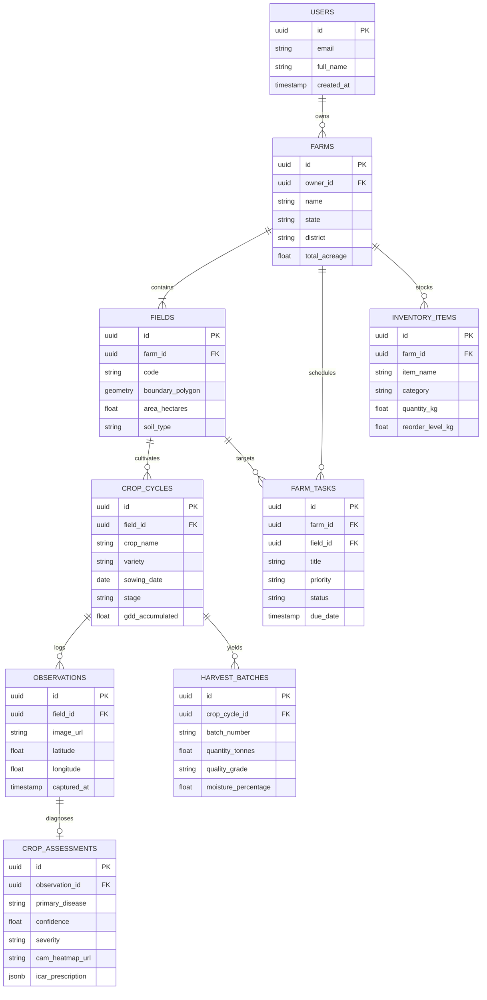

---

## 9. Quick Start & Local Setup

### 9.1 Windows (PowerShell)

```powershell
# 1. Clone repository & enter workspace
git clone https://github.com/TanishBane/Nexfield.git
cd Nexfield

# 2. Install monorepo dependencies
pnpm install

# 3. Setup Python virtual environment & backend dependencies
py -m venv .venv
.\.venv\Scripts\Activate.ps1
pip install -r services/api/requirements.txt

# 4. Configure local environment variables
Copy-Item apps/web/.env.example apps/web/.env.local
Copy-Item services/api/.env.example services/api/.env

# 5. Run full test verification suites
py -m pytest services/api/tests   # 78 backend unit & integration tests
pnpm type-check                   # Zero TypeScript errors
pnpm test                         # Frontend Vitest suites
pnpm test:e2e                     # 10-point system smoke suite

# 6. Start full-stack development environment concurrently
pnpm dev
# Open http://localhost:3000 in your browser
```

### 9.2 macOS / Linux (Bash)

```bash
# 1. Clone repository & enter workspace
git clone https://github.com/TanishBane/Nexfield.git
cd Nexfield

# 2. Install monorepo dependencies
pnpm install

# 3. Setup Python virtual environment & backend dependencies
python3 -m venv .venv
source .venv/bin/activate
pip install -r services/api/requirements.txt

# 4. Configure local environment variables
cp apps/web/.env.example apps/web/.env.local
cp services/api/.env.example services/api/.env

# 5. Run full test verification suites
pytest services/api/tests         # 78 backend unit & integration tests
pnpm type-check                   # Zero TypeScript errors
pnpm test                         # Frontend Vitest suites
pnpm test:e2e                     # 10-point system smoke suite

# 6. Start full-stack development environment concurrently
pnpm dev
# Access http://localhost:3000
```

---

## 10. Scientific Grounding & Post-Harvest Spoilage Engine

NEXFIELD's biophysical models adhere strictly to international agronomic literature:

### 10.1 FAO-56 Penman-Monteith Reference Evapotranspiration
$$ET_o = \frac{0.408 \Delta (R_n - G) + \gamma \frac{900}{T + 273} u_2 (e_s - e_a)}{\Delta + \gamma (1 + 0.34 u_2)}$$

### 10.2 Stewart's Deficit Irrigation Yield Response Function
$$\left(1 - \frac{Y_a}{Y_m}\right) = K_y \left(1 - \frac{ET_a}{ET_c}\right)$$

### 10.3 Domain 2: Post-Harvest Spoilage Risk Engine
In food technology, up to 30% of harvested food degrades in storage. NEXFIELD evaluates critical thresholds based on ICAR and FAO Bulletin 149 standards:
- **Tomato Cold Storage:** If storage temperature drops below $10^\circ\text{C}$, a **Chilling Injury Alert** is triggered to prevent surface pitting and flavor deterioration.
- **Wheat Grain Silos:** If grain moisture exceeds $14.0\%$, a **Mold & Aflatoxin Warning** is dispatched to activate aeration drying fans.
- **Rice Milling Facilities:** If moisture swings exceed $2.5\%$ in 6 hours, a **Kernel Fissuring Warning** alerts the facility manager to prevent broken grains during dehusking.

---

## 11. Capability Matrix & Calibration Status

| Feature / Subsystem | Implementation Status | Scientific / Data Foundation | Roadmap & Calibration Notes |
|---|---|---|---|
| **Command Center HUD** | **Implemented** | Sensor telemetry & Open-Meteo forecasts | Fully wired to live hooks and fallback fixtures. |
| **FieldSight Pathology** | **Implemented** | ONNX Runtime (`fieldsight_foliar_v1.onnx`) | $5.13\text{ ms}$ CPU inference; calibrated on synthetic botanical signatures; clinical field trials planned. |
| **Spatial CAM Heatmaps** | **Implemented** | Conv3 layer activation extraction | Verified bilinear upscaling and color mapping. |
| **3D WebGL Digital Twin** | **Implemented** | FAO-56 Penman-Monteith physics | Real-time Three.js WebGL canvas with procedural shaders. |
| **Agronomic Copilot** | **Implemented** | Context-grounded LLM prompts + ICAR | Live farm telemetry injection and tool cards. |
| **Operations Ledger** | **Implemented** | Reactive state + Supabase schema | Automated inventory balance deductions. |
| **Mandi Price Arbitrage** | **Implemented** | AGMARKNET daily bulletins & freight math | Haulage distance matrix optimization. |
| **Post-Harvest Spoilage** | **Implemented** | ICAR & FAO Bulletin 149 criteria | Tomato chilling injury ($<10^\circ\text{C}$), grain moisture ($>14\%$). |
| **PostGIS Spatial Queries** | **Implemented** | PostgreSQL 15 + PostGIS | Polygon storage, GIST indexing, centroid calculations. |
| **Tenant Isolation (RLS)** | **Implemented** | Supabase GoTrue + RLS | Cryptographic ownership check (`Farm.owner_id == user.id`). |

---

## 12. Team Roles & Engineering Governance

NEXFIELD is co-developed by an integrated engineering team operating under strict directory ownership laws defined in [`AGENTS.md`](AGENTS.md):

| Contributor | Primary Roles | Exclusive Directory Ownership | Agentic Toolchain |
|---|---|---|---|
| **Tanish Bane**<br>[@TanishBane](https://github.com/TanishBane) | **Frontend Lead & Product Architect** | `apps/web/**`, `packages/ui/**`, WebGL Twin, HUD components, client stores | Google Antigravity & Google Jules |
| **Rohan Panchal**<br>[@panchalrohan44](https://github.com/panchalrohan44) | **Backend Lead & ML Systems Architect** | `services/api/**`, `services/api/alembic/**`, `ml/**`, PostGIS models, Mandi scrapers | OpenAI Codex & GitHub Copilot |

- **Shared Architecture Council:** `packages/contracts/**`, `docs/contracts/**`, `data/fixtures/**`, `.github/workflows/**`.
- **Governance Invariant:** Neither developer may unilaterally alter schemas, database columns, or payload structures without consensus.

---

## 13. License & Attribution

NEXFIELD's original source code is licensed under the [MIT License](LICENSE). See [LICENSE](LICENSE) for details. Third-party datasets, model assets, and other externally licensed materials remain subject to their respective terms.

- **License:** [MIT License](LICENSE) — Copyright (c) 2026 Tanish Bane and Rohan Panchal.
- **Hackathon:** Developed for **ADAPPT 5.0 — Round 2 — Domain 2: AI in Food Technology**.
- **Agronomic Standards:** Equations adapted from *FAO Irrigation and Drainage Paper 56* (*FAO-56 Penman-Monteith*) and *FAO Agricultural Services Bulletin 149*.
- **Extension Protocols:** Treatment protocols adhere to published guidelines of the *Indian Council of Agricultural Research (ICAR)*.

---

<div align="center">
  <p>© 2026 NEXFIELD Contributors.</p>
  <p>
    <strong>Maintained by:</strong><br/>
    Tanish Bane — <a href="https://github.com/TanishBane">@TanishBane</a><br/>
    Rohan Panchal — <a href="https://github.com/panchalrohan44">@panchalrohan44</a>
  </p>
  <p>Licensed under the <a href="LICENSE">MIT License</a>.</p>
  <sub>Observe. Predict. Simulate. Optimize. Grow.</sub>
</div>
