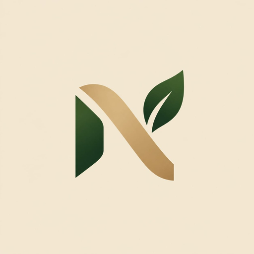
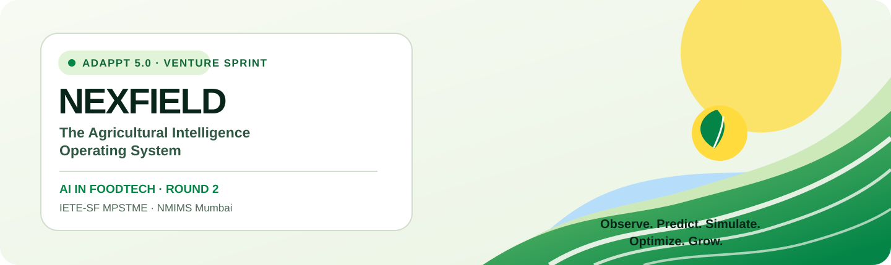
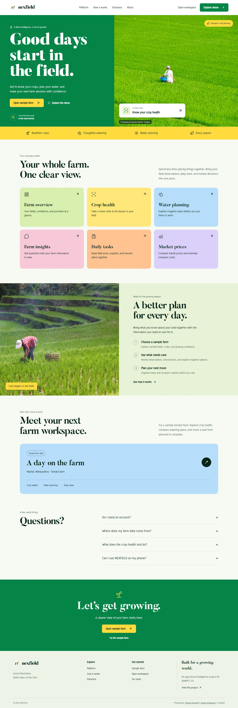
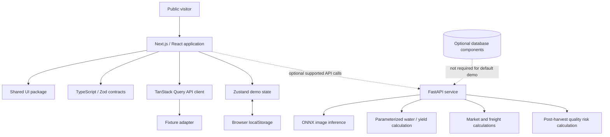

<!-- NEXFIELD README: source-backed product overview for the current public demo. -->

<div align="center">
  
  

  <p><strong>The Agricultural Intelligence Operating System</strong></p>
  <p><em>Observe. Predict. Simulate. Optimize. Grow.</em></p>

  <p>
    <a href="https://nexfield-agritech.vercel.app/"><strong>Open the live demo ↗</strong></a>
    &nbsp;·&nbsp;
    <a href="https://adappt.ietempstme.com/"><strong>ADAPPT 5.0 — Official Event ↗</strong></a>
    &nbsp;·&nbsp;
    <a href="#explore-the-six-modules">Explore modules</a>
    &nbsp;·&nbsp;
    <a href="#run-locally">Run locally</a>
  </p>

  <p>
    <a href="https://github.com/TanishBane/Nexfield/actions/workflows/frontend-ci.yml"></a>
    <a href="https://github.com/TanishBane/Nexfield/actions/workflows/backend-ci.yml"></a>
    <a href="LICENSE"></a>
    <a href="https://nexfield-agritech.vercel.app/"></a>
  </p>
</div>

---

## ADAPPT 5.0 · Venture Sprint · AI in FoodTech

NEXFIELD was developed for **ADAPPT 5.0**, the innovation-focused Venture Sprint associated with **IETE-SF MPSTME, NMIMS Mumbai**, in the **AI in FoodTech — Round 2** domain.

The 2026 event listing describes the Venture Sprint as taking place on **23–24 October 2026**. Explore the event through the [official ADAPPT website](https://adappt.ietempstme.com/) and the [event overview](https://www.vybedriven.in/opportunities/adappt-5-0).

> This section documents the project's event context. It does not claim that NEXFIELD won, placed, or received an endorsement from the organizers.

## What is NEXFIELD?

**NEXFIELD is an agricultural decision-support platform that brings farm overview, crop-image analysis, water-planning scenarios, farm operations, and market comparison into one connected workspace.**

Agricultural decisions are linked. A crop observation may trigger an inspection; a water scenario can inform a task; inventory and cost records affect execution; and a market's quoted price does not by itself tell a grower what remains after transport and handling costs.

NEXFIELD aims to make these connections easier to explore through a consistent interface and transparent assumptions. The project combines a modern web experience with an optional Python API for supported computation and inference workflows.

### Project snapshot

| | |
|---|---|
| Product | NEXFIELD — The Agricultural Intelligence Operating System |
| Challenge | ADAPPT 5.0 · Venture Sprint |
| Domain | AI in FoodTech · Round 2 |
| Event host | IETE-SF MPSTME, NMIMS Mumbai |
| Live website | [nexfield-agritech.vercel.app](https://nexfield-agritech.vercel.app/) |
| Frontend | Next.js App Router, React, TypeScript |
| Visualization | Three.js, React Three Fiber, Drei, ECharts |
| Client state | Zustand, TanStack Query |
| Shared contracts | TypeScript and Zod |
| Optional API | FastAPI, Python, Pydantic |
| Default experience | Public, no-login demo |
| Demo persistence | Browser-local state, not shared cloud storage |
| License | [MIT](LICENSE) |

## The problem and our approach

Farm information is often scattered across paper notes, separate applications, field images, local market information, and manual calculations. NEXFIELD explores a single operational journey rather than claiming to replace agronomists, field measurements, government data providers, or validated agricultural research.

| Challenge | NEXFIELD response | Intended practical value |
|---|---|---|
| Farm information is fragmented | **Control** presents sample farm context, fields, crop cycles, observations, tasks, and supported indicators | A clearer overview of the work ahead |
| Crop symptoms need closer inspection | **FieldSight AI** provides an image-analysis workflow and presents available diagnostic output | A structured starting point for crop-health investigation |
| Irrigation choices involve trade-offs | **Twin** offers a 3D field view and parameterized scenario comparisons | Make assumptions and scenario differences easier to inspect |
| Advice needs context | **Intelligence** presents a farm-oriented conversational interface and context cues | Keep relevant farm context near the user's question |
| Work and resources need coordination | **Ops** organizes tasks and available inventory/expense workflows | Improve day-to-day operational visibility |
| Price is not the same as net return | **Markets** combines market observations with transport-cost calculations where supported | Compare quoted price with stated cost assumptions |

These are intended product benefits, not independently measured improvements. NEXFIELD does not claim proven yield gains or validated reductions in food waste.

## Explore the six modules

The selected interface direction is **Vivid Farming**: light surfaces, leaf-green navigation, sunflower accents, sky blue and other restrained module colors, farm photography, clearer headings, and direct routes into the tools. The public marketing pages and farm workspace are designed to feel like the same product.

| Module | Open it | Purpose |
|---|---|---|
| **NEXFIELD Control** | [Open Control ↗](https://nexfield-agritech.vercel.app/control) | Review the sample farm, relevant fields/crop cycles, observations, priorities, activity and supported indicators. |
| **FieldSight AI** | [Open FieldSight ↗](https://nexfield-agritech.vercel.app/fieldsight) | Explore image upload, crop-health analysis presentation, evidence, and available model/fixture provenance. |
| **NEXFIELD Twin** | [Open Twin ↗](https://nexfield-agritech.vercel.app/twin) | Inspect the interactive 3D field, adjust supported parameters, compare scenario outputs, and review assumptions. |
| **NEXFIELD Intelligence** | [Open Intelligence ↗](https://nexfield-agritech.vercel.app/intelligence) | Explore the contextual conversation interface, suggested questions, and available action/tool presentation. |
| **NEXFIELD Ops** | [Open Ops ↗](https://nexfield-agritech.vercel.app/ops) | Review tasks, their statuses and priorities, inventory-related views, expenses, and supported operational workflows. |
| **NEXFIELD Markets** | [Open Markets ↗](https://nexfield-agritech.vercel.app/markets) | Inspect commodity/market filters, available price observations, comparisons and transport-cost calculations. |

Additional pages: [Homepage](https://nexfield-agritech.vercel.app/), [Guided demo](https://nexfield-agritech.vercel.app/demo), [Platform overview](https://nexfield-agritech.vercel.app/platform), [How it works](https://nexfield-agritech.vercel.app/how-it-works), [About](https://nexfield-agritech.vercel.app/about), and [Data Center](https://nexfield-agritech.vercel.app/data-center).

### Suggested product walkthrough

1. Open **Control** and inspect the sample farm context.
2. Visit **FieldSight AI** to explore the crop-inspection workflow.
3. Open **Twin** to adjust supported irrigation or crop-planning assumptions and compare scenario outputs.
4. Explore **Intelligence** with a farm-related question.
5. Review **Ops** and try supported task or local-demo-state interactions.
6. Use **Markets** to compare available price information and transport assumptions.

This is an illustrative journey. Whether a step uses local fixtures or an API depends on the deployed configuration.

### Current homepage preview

The following preview is stored in the repository's Vivid Farming UI handoff:



For the latest route behavior, open the [live website](https://nexfield-agritech.vercel.app/). Older screenshots elsewhere in the repository may represent earlier visual iterations.

## What is real, and what is demo data?

NEXFIELD distinguishes application behavior from claims about data provenance.

### Default public demo

- The primary workspace is explorable without signing in.
- The frontend defaults to fixture mode unless `NEXT_PUBLIC_USE_FIXTURES=false` is configured.
- The demo store uses Zustand and browser-local persistence, including the `nexfield-demo-v1` local-storage key.
- Demo state belongs to the browser and is not shared cloud persistence or a backup.
- Resetting the demo restores the local baseline state.
- Synthetic/baseline observations are not live sensor telemetry, live market feeds, or field-validated model results.

### Optional computation API

The repository contains a FastAPI service for supported stateless inference and calculation endpoints. Having a route in the source code does not mean an external provider is configured or that every database-backed workflow is available on the deployed public demo.

| Area | Current interpretation |
|---|---|
| **Crop diagnosis** | An ONNX inference path exists. Model calibration and field-validation limits remain important; fixture output is not live inference. |
| **Water requirement** | The scheduled irrigation-volume endpoint calculates a volume from the supplied area, event count and per-hectare amount. It does not independently calculate a dynamic daily FAO-56 soil-water balance. |
| **Twin simulation** | The API contains a parameterized water/yield scenario calculation. Its outputs are estimates based on stated assumptions, not validated farm forecasts. |
| **Intelligence** | The interface provides contextual conversation and action presentation. Do not assume an external LLM is active unless the deployment has the provider configured. |
| **Markets and weather** | Check each screen's source/provenance labels. Fixtures are not evidence of a live provider connection. |
| **Persistence** | Public-demo mutations use browser-local state. Do not assume shared multi-user database storage for the demo. |

Read the [Public Demo Architecture](docs/architecture/PUBLIC_DEMO_ARCHITECTURE.md), [AI & Models notes](docs/AI_AND_MODELS.md), and [Capability Matrix](docs/architecture/CAPABILITY_MATRIX.md) alongside the source code. If a document and the current code disagree, verify the actual implementation before repeating a claim.

## Architecture

NEXFIELD is a pnpm monorepo: the Next.js application is the primary public experience, and the Python API provides optional computation/inference services.



### Architectural principles

- **Frontend:** Next.js App Router, React components, and TypeScript in `apps/web`.
- **Shared UI:** reusable UI primitives and design tokens in `packages/ui`.
- **Contracts:** shared Zod schemas and TypeScript types in `packages/contracts`.
- **Data presentation:** TanStack Query and the API client, with fixture-first behavior for the public demo.
- **Client state:** Zustand and guarded browser-local persistence.
- **3D:** Three.js, React Three Fiber, and Drei for the Twin.
- **Charts:** ECharts for supported charting workflows.
- **Backend:** FastAPI, Pydantic, and Python computation/inference code in `services/api`.
- **Inference:** ONNX Runtime for the available vision pipeline.
- **Engineering checks:** Vitest, Pytest, Playwright-based smoke tests and GitHub Actions.

The default public demo does not require Supabase Auth or a remote database. Older design/architecture documents may describe prior iterations. Use [Public Demo Architecture](docs/architecture/PUBLIC_DEMO_ARCHITECTURE.md) and inspect current source before relying on a statement about runtime behavior.

## Technology stack

| Layer | Technology | Role |
|---|---|---|
| Web framework | Next.js 15, React 19, TypeScript | Routing, UI composition and interactions |
| Styling | Tailwind CSS, `@nexfield/ui` | Responsive styling and shared components |
| Motion | Motion, GSAP/ScrollTrigger | Selected UI and storytelling transitions |
| 3D | Three.js, React Three Fiber, Drei | Interactive Twin visualization |
| Charts | ECharts | Analytical and scenario charts |
| State and request caching | Zustand, TanStack Query | Demo state and asynchronous data state |
| Contract validation | Zod, Pydantic v2 | Frontend schemas and backend payload validation |
| API | Python, FastAPI, Uvicorn | Optional computation and inference service |
| Numerical / ML tooling | ONNX Runtime, NumPy, pandas, SciPy, scikit-learn | Available inference and numerical workflows |
| Data libraries | SQLAlchemy, asyncpg, GeoAlchemy, Shapely, Alembic | Database/spatial components in the repository; not needed for browser-local demo storage |
| Testing | Vitest, Pytest, Playwright | Unit, API and browser smoke verification |
| Hosting / collaboration | Vercel, GitHub Actions | Web deployment and repository workflows |

Exact versions are defined in the package manifests and `services/api/requirements.txt`; inspect those files for the current dependency versions.

## Data provenance and agronomic methodology

NEXFIELD brings together several kinds of information, and they should not be interpreted as interchangeable:

| Information type | Typical example | How to read it |
|---|---|---|
| User-provided inputs | Crop, field size, irrigation schedule, image upload | Values entered or selected by the visitor; accuracy depends on the input. |
| Demonstration fixtures | Sample-farm profile, sample tasks, baseline market or weather cards | Synthetic example data for exploring the interface; not a live sensor reading. |
| Deterministic calculations | Scheduled irrigation volume and freight/net-realization arithmetic | Reproducible calculation from specified inputs and assumptions; not a measurement. |
| Model output | Crop-image inference or a parameterized yield scenario | Algorithmic output with model and calibration limitations; not a guarantee of an outcome. |
| External-provider data | Any supported weather or market adapter when configured | Must be interpreted with its source, retrieval time and provider availability. A code path alone does not prove a feed is active in the deployed environment. |

### FieldSight AI

The repository includes an ONNX Runtime inference path for crop-image analysis. A diagnostic interface can show a class, score, severity, image evidence and a heatmap-like explanation when those outputs are actually provided by the configured pipeline. Model scores are not probabilities of certainty for every field condition. The model's training/calibration scope and field-validation status must be considered before using its output in real operations. Ask an agricultural specialist to confirm a diagnosis and treatment decision.

### NEXFIELD Twin

The scheduled irrigation-volume endpoint performs a volume calculation using the inputs supplied to it. A basic unit relationship is that an application depth of 1 mm corresponds to 10 m³/ha. A scheduled-volume calculation is not by itself a daily root-zone water balance. The separate scenario endpoint uses a parameterized water/yield calculation with specified baseline assumptions; it should be treated as an exploratory estimate, not a calibrated prediction for a particular farm. Do not infer weather-station telemetry, continuous ET₀ measurements or field-validated yield response unless the required sources and models are actually configured.

### Markets and net realization

A quoted mandi price is not necessarily a farmer's realized return. A transport-adjusted comparison depends on the selected price observation, quantity, transport and handling assumptions, and any other costs included by the implemented calculator. Verify the date, unit, market and source for price records. An estimate is not a purchase offer or a guaranteed profit.

## FoodTech decision journey

NEXFIELD's six modules are intentionally complementary rather than six disconnected dashboards:

1. **Observe:** start with the chosen sample farm, field profile and available observations in Control.
2. **Inspect:** use FieldSight's image workflow to explore the evidence and limitations of a crop-health analysis.
3. **Compare:** use Twin to examine supported parameter changes and compare the resulting estimates with the baseline.
4. **Interpret:** use Intelligence to explore questions in the context provided by the current demo and its configured response path.
5. **Plan:** use Ops to review supported work items, priorities, resources and costs.
6. **Evaluate:** use Markets to compare available market information alongside stated transport assumptions.

This journey illustrates the intended product workflow. It does not mean that every module currently has an automated event-to-action integration or that all data is synchronized with a remote database. Read the current implementation before describing an end-to-end automation as implemented.

## Development and contribution workflow

NEXFIELD uses a monorepo and directory ownership model so that the UI, backend and shared contracts can evolve without silently breaking one another.

- Read `AGENTS.md` before using an AI coding agent or assigning a change.
- Create a focused branch and keep unrelated work out of the change.
- For frontend changes, follow the Vivid Farming direction and shared primitives in `packages/ui`.
- For backend changes, preserve FastAPI error envelopes, input validation, auth boundaries and security tests.
- For a contract or fixture change, coordinate with the relevant owner and update frontend/backend expectations together.
- For documentation changes, verify each feature claim against code and distinguish current functionality from planned work.
- Run the relevant type checks, lint, unit tests, API tests, production build and browser smoke tests before reporting a result.
- Open a pull request with a concise summary, test evidence, screenshots when the UI changes, and unresolved limitations. Do not merge or deploy without the repository owner's approval.

GitHub Copilot guidance is kept in `.github/copilot-instructions.md` and `.github/instructions/`; the reusable review prompt is in `.github/prompts/`. Repository-wide and path-specific instructions supplement the source code and the governance rules rather than overriding them.

## Run locally

### Prerequisites

- Node.js 20+
- pnpm 9+
- Python compatible with the API dependencies (CI currently uses Python 3.12)
- Git

### 1. Clone and install

```bash
git clone https://github.com/TanishBane/Nexfield.git
cd Nexfield
pnpm install --frozen-lockfile
```

### 2. Run the web app

```bash
pnpm dev
```

Open [http://localhost:3000](http://localhost:3000). The fixture-first public demo can be explored without Supabase credentials or an account.

### 3. Optional: run the FastAPI service

Create a Python virtual environment from the repository root.

**Windows PowerShell**

```powershell
py -3.12 -m venv .venv
.\.venv\Scripts\Activate.ps1
python -m pip install -r services/api/requirements.txt
python -m uvicorn services.api.main:app --reload --port 8000
```

**macOS / Linux**

```bash
python3 -m venv .venv
source .venv/bin/activate
python -m pip install -r services/api/requirements.txt
python -m uvicorn services.api.main:app --reload --port 8000
```

To test supported backend endpoints from the frontend, set `NEXT_PUBLIC_API_BASE_URL=http://localhost:8000` and `NEXT_PUBLIC_USE_FIXTURES=false` in `apps/web/.env.local`, then restart Next.js. Not every database-backed endpoint is available without its required database/authentication dependencies. A successful frontend build does not prove every integration is online.

### Secrets and environment files

- Inspect repository `.env.example` files before configuring optional integrations.
- Keep credentials in local environment files or protected GitHub/Vercel secrets.
- Never commit provider keys, database passwords, user records or production-only configuration.
- Variables prefixed with `NEXT_PUBLIC_` are exposed to the browser and must never contain secrets.

## Checks and tests

Use the scripts actually defined by the repository:

```bash
pnpm type-check
pnpm lint
pnpm test
pnpm build
pnpm test:e2e
```

Backend suite, from the repository root:

```bash
python -m pytest services/api
```

The frontend CI workflow runs contract/UI/web type checks, lint, Vitest, and the Next.js production build. The backend CI workflow installs API requirements and runs Pytest. Check the latest [Frontend CI runs](https://github.com/TanishBane/Nexfield/actions/workflows/frontend-ci.yml) and [Backend CI runs](https://github.com/TanishBane/Nexfield/actions/workflows/backend-ci.yml) for current results; this README avoids hard-coded pass counts because they can become stale.

## Repository map

```text
Nexfield/
├── apps/web/               # Next.js routes, components and frontend state
├── packages/contracts/     # Shared TypeScript / Zod schemas
├── packages/ui/            # Shared UI components and tokens
├── services/api/            # FastAPI service, inference/calculation and tests
├── data/fixtures/           # Demonstration data
├── docs/                    # Product, architecture, event and implementation docs
├── scripts/                 # Development and verification helpers
├── tests/                   # Smoke and browser tests
├── .github/
│   ├── workflows/           # CI
│   ├── instructions/        # Path-specific Copilot instructions
│   ├── prompts/             # Reusable Copilot prompts
│   └── copilot-instructions.md
├── AGENTS.md                # Project-specific agent ownership and governance
├── package.json
└── pnpm-workspace.yaml
```

## Working with GitHub Copilot

This repository uses multiple coding agents and directory-ownership rules. Read [AGENTS.md](AGENTS.md) before making changes. Copilot guidance is organized as follows:

- [Repository-wide instructions](.github/copilot-instructions.md)
- [Frontend instructions](.github/instructions/frontend.instructions.md)
- [Backend instructions](.github/instructions/backend.instructions.md)
- [Contracts and fixtures instructions](.github/instructions/shared-contracts.instructions.md)
- [Documentation instructions](.github/instructions/documentation.instructions.md)
- [Reusable final-review prompt](.github/prompts/nexfield-final-review.prompt.md)

These files supplement, but do not replace, source code, tests, schemas, and ownership boundaries. Copilot should preserve the selected Vivid Farming design, respect the zero-login public demo, distinguish fixtures from live data, avoid changing shared contracts without coordination, and never fabricate test results. See [GitHub's documentation for repository custom instructions](https://docs.github.com/en/copilot/how-tos/copilot-in-your-ide/customize-copilot/configure-custom-instructions/add-repository-instructions-in-your-ide).

## Project documentation

| Document | Purpose |
|---|---|
| [Product overview](docs/PRODUCT_OVERVIEW.md) | Product purpose and module boundaries |
| [Public demo architecture](docs/architecture/PUBLIC_DEMO_ARCHITECTURE.md) | No-login experience, browser state and optional API |
| [AI & models](docs/AI_AND_MODELS.md) | Model scope, calculations and limitations |
| [Capability matrix](docs/architecture/CAPABILITY_MATRIX.md) | Feature status and caveats |
| [Demo guide](docs/DEMO_GUIDE.md) | Walkthrough of available demo workflows |
| [Data flow](docs/DATA_FLOW.md) | Data sources, validation and provenance |
| [Deployment](docs/DEPLOYMENT.md) | Hosting and deployment notes |
| [Security policy](SECURITY.md) | Reporting a vulnerability |
| [ADAPPT 5.0 event brief](docs/ADAPPT_5_EVENT.md) | Event context and project framing |
| [Agent governance](AGENTS.md) | Directory ownership and coordination |

## Team

- **Tanish Bane** — [@TanishBane](https://github.com/TanishBane)
- **Rohan Panchal** — [@panchalrohan44](https://github.com/panchalrohan44)

Credit follows actual commits and pull requests. Coding agents are tools, not human contributors.

## Roadmap and limitations

Possible next steps include broader real-world crop-model validation, improved image-model calibration across crops and seasons, more robust agricultural data imports, stronger market-source freshness reporting, additional field-data integrations, better offline support, and more testing of real provider configurations.

NEXFIELD is a prototype and decision-support experience. It is not a substitute for qualified agronomic advice, laboratory diagnostics, field measurements, official market data, or validated agricultural models. Review model assumptions and source freshness before using any result in a real operational decision.

## License

NEXFIELD is licensed under the [MIT License](LICENSE). Third-party assets, photographs, fonts, data and model weights remain subject to their own terms and licenses.
