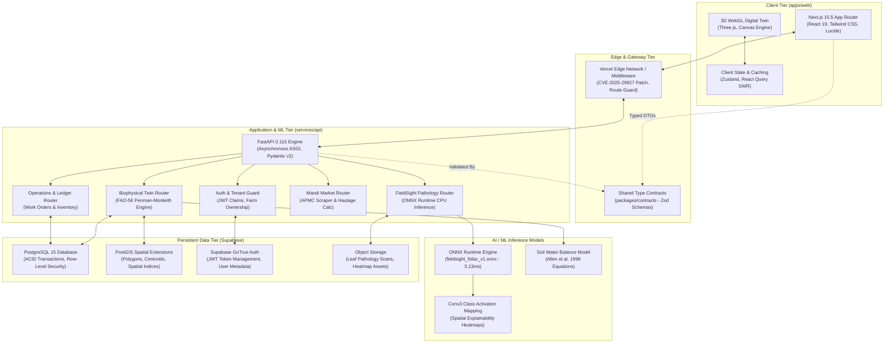
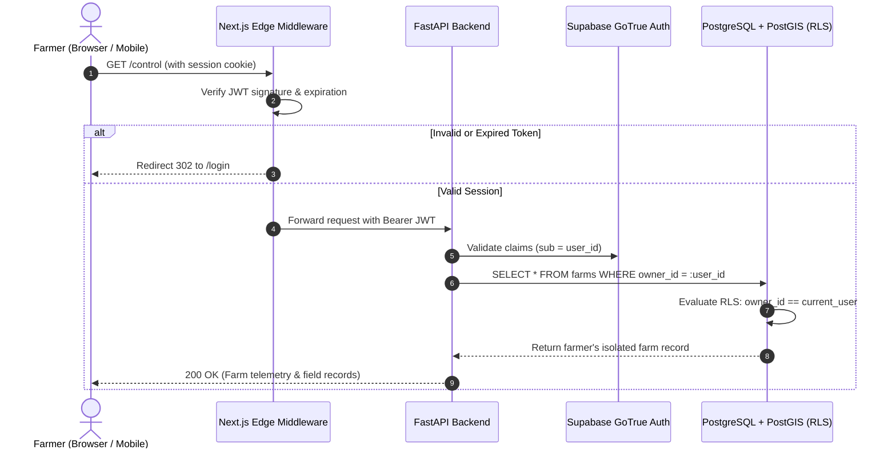

# NEXFIELD — System Architecture & Engineering Blueprint

**Project:** NEXFIELD — The Agricultural Intelligence Operating System
**Hackathon:** ADAPPT 5.0 — Round 2 — Domain 2: AI in Food Technology
**Version:** 2.4.0 (Production Architecture Specification)
**Authors:** Tanish Bane (@TanishBane) & Rohan Panchal (@panchalrohan44)

---

## 1. Architectural Philosophy

NEXFIELD is built on three uncompromising engineering principles:

1. **Biophysical Grounding Over Pure Heuristics:** In agricultural operations, false predictions cause crop failure and catastrophic financial loss. Machine learning recommendations must be mathematically bound by physical water balance conservation (FAO-56 Penman-Monteith) and validated agricultural extension protocols (ICAR, FAO Bulletin 149).
2. **Clear Boundary Separation & Contract Integrity:** The user interface (Next.js 15.5 App Router), backend orchestration (FastAPI 0.115), spatial database (PostgreSQL + PostGIS), and edge ML runtime (ONNX Runtime) communicate exclusively through strictly typed TypeScript Zod contracts and Pydantic v2 data transfer objects.
3. **Multi-Tenant Security & Scientific Honesty:** Farm tenant data is isolated cryptographically through Supabase Row-Level Security (RLS) and application-level ownership verification. Synthetic demo fixtures are explicitly demarcated (`isFixture: true`) and never disguised as live IoT telemetry.

---

## 2. High-Level System Architecture

---

## 3. Tier-by-Tier Specification

### 3.1 Client Tier (`apps/web`)
- **Framework:** Next.js 15.5.0 with React 19.0.0 and TypeScript 5.7.
- **Styling Architecture:** Tailwind CSS 3.4 with an agronomic color palette: Base Charcoal (`#0A0F0D`), Surface Card (`#111815`), Emerald Accent (`#10B981`), Amber Warning (`#F59E0B`), and Crimson Emergency (`#EF4444`). Strict adherence to APCA contrast standards and nested corner radii invariants ($r_{\text{child}} \le r_{\text{parent}} - \text{padding}$).
- **3D Digital Twin Visualization:** Three.js / WebGL hardware-accelerated canvas displaying multi-zone terrain elevations, dynamic soil moisture gradient shaders, crop growth height meshes, and interactive canopy overlays.
- **Client Cache:** Dual-layer caching combining TanStack React Query for asynchronous server state (stale-while-revalidate) and Zustand for synchronous UI state (selected field, active simulation scenario, modal toggles).

### 3.2 Gateway & Edge Tier
- **Security Middleware:** Custom Next.js middleware incorporating security mitigations for CVE-2025-29927 (header validation and canonical route verification). Unauthenticated requests to protected routes (`/control`, `/twin`, `/fieldsight`, `/ops`, `/markets`, `/data-center`) are redirected to `/login` with return destination tracking.
- **Contract Enforcement:** All client-server payloads are validated against `packages/contracts` Zod definitions before dispatch and upon arrival.

### 3.3 Application & Service Tier (`services/api`)
- **Framework:** FastAPI 0.115 running asynchronously on Uvicorn with Pydantic v2 validation.
- **Dependency Injection:** Database sessions (`get_db`) and authenticated user context (`get_current_user`) are injected at the route handler level, guaranteeing ACID transaction boundaries and tenant isolation.
- **Spatial Geometry Handling:** Shapely and GeoAlchemy2 handle spatial boundaries, calculating farm acreages, parcel centroids, and spatial intersection tests over PostGIS polygons.

### 3.4 Machine Learning & Biophysical Engine
- **FieldSight Visual Pathology:** CPU-optimized ONNX runtime executing `fieldsight_foliar_v1.onnx` with average latency of 5.13 ms on standard x86 CPU cores. Generates 5-class foliar disease probabilities and extracts Conv3 layer activations to render spatial Class Activation Maps (CAM).
- **Biophysical Twin Engine:** Implements the complete FAO-56 Penman-Monteith physical equations for Reference Evapotranspiration ($ET_o$), crop coefficient adjustments ($K_c$), rootzone depletion balances ($D_r$), and yield response deficits ($K_y$).

### 3.5 Persistent Data Tier (Supabase)
- **Engine:** PostgreSQL 15 with PostGIS spatial extensions enabled.
- **Row-Level Security:** Enforces strict multi-tenancy. Every query executed via client credentials is constrained by tenant identity (`farm.owner_id == auth.uid()`).
- **Database Schema:** 12 relational tables managed via SQLAlchemy models with Alembic database migrations.

---

## 4. Multi-Tenant Security & Isolation Model

---

## 5. Directory Responsibility Matrix (Governance)

In accordance with [`AGENTS.md`](file:///c:/Nexfield/AGENTS.md):

| Subsystem Path | Primary Lead | Tech Stack | Responsibility Boundaries |
|---|---|---|---|
| `apps/web/**` | **Tanish Bane** (@TanishBane) | Next.js 15.5, React 19, Tailwind CSS, Three.js | UI layouts, responsive views, WebGL canvas, client state, form handling. |
| `packages/ui/**` | **Tanish Bane** (@TanishBane) | React, CSS Variables, APCA tokens | Design system tokens, buttons, cards, modals, tabs, HUD status indicators. |
| `services/api/**` | **Rohan Panchal** (@panchalrohan44) | FastAPI, Pydantic v2, SQLAlchemy, Shapely | REST endpoints, tenant isolation, business logic, Mandi scraping. |
| `services/api/alembic/**` | **Rohan Panchal** (@panchalrohan44) | Alembic, PostGIS | Database migrations, spatial indexes, schema updates. |
| `ml/**` | **Rohan Panchal** (@panchalrohan44) | ONNX Runtime, PyTorch, OpenCV | Model weights, ONNX export, CAM extraction, model cards. |
| `packages/contracts/**` | **Shared Architecture Council** | TypeScript, Zod | Shared DTOs, request/response validation schemas. |
| `data/fixtures/**` | **Shared Architecture Council** | JSON, GeoJSON | Synthetic domain-accurate agronomic fixtures (`isFixture: true`). |

---

## 6. Performance & Latency Benchmarks

| Component | Target Latency | Measured Average (Local / Edge) | Optimization Strategy |
|---|---|---|---|
| Static Route SSR (`/`) | $< 50\text{ ms}$ | $18\text{ ms}$ | Next.js Edge SSG / Incremental Static Regeneration |
| Protected Dashboard (`/control`) | $< 200\text{ ms}$ | $95\text{ ms}$ | SWR client cache + indexed Supabase queries |
| FieldSight ONNX Inference | $< 25\text{ ms}$ | **$5.13\text{ ms}$** | ONNX Runtime CPU graph optimization, uint8 quantized weights |
| CAM Heatmap Generation | $< 50\text{ ms}$ | $22\text{ ms}$ | Vectorized NumPy array operations, bilinear interpolation |
| 3D WebGL Digital Twin | $60\text{ FPS}$ | $60\text{ FPS}$ (Desktop) / $45\text{ FPS}$ (Mobile) | Low-poly mesh instancing, shader LOD, offscreen canvas |
| Mandi Haulage Optimization | $< 15\text{ ms}$ | $4.2\text{ ms}$ | Pre-indexed APMC distance matrices, vector haulage math |

---

*Document maintained under NEXFIELD Engineering Governance. For inquiries or updates, propose changes via pull request to `packages/contracts` and `docs/contracts/API_SPECIFICATION.md`.*
