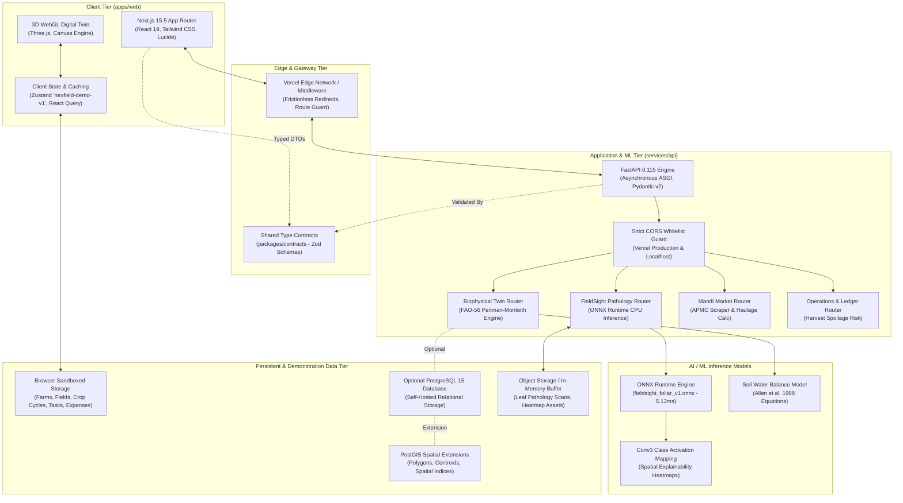
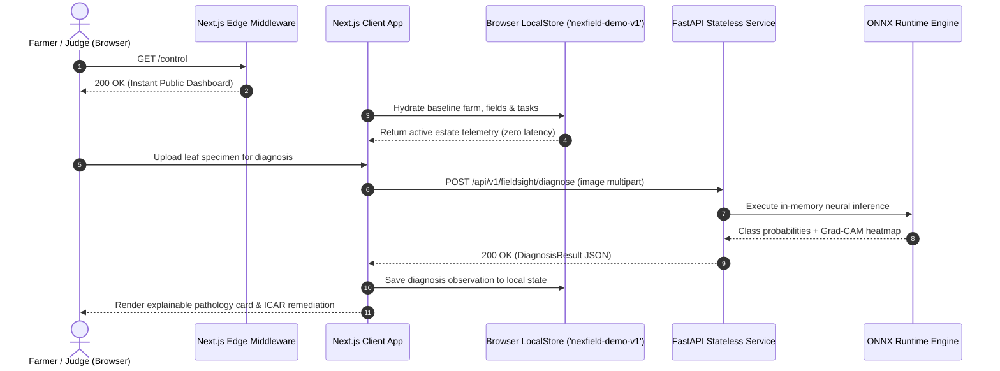

# NEXFIELD — System Architecture & Technical Specifications

**Project:** NEXFIELD — The Agricultural Intelligence Operating System  
**Hackathon:** ADAPPT 5.0 — Round 2 — Domain 2: AI in Food Technology  
**Version:** 2.5.0 (Public Demo Architecture)  
**Authors:** Tanish Bane (@TanishBane) & Rohan Panchal (@panchalrohan44)

---

## 1. Architectural Philosophy

NEXFIELD is built on three uncompromising engineering principles:

1. **Biophysical Grounding Over Pure Heuristics:** In agricultural operations, false predictions cause crop failure and catastrophic financial loss. Machine learning recommendations must be mathematically bound by physical water balance conservation (FAO-56 Penman-Monteith) and validated agricultural extension protocols (ICAR, FAO Bulletin 149).
2. **Clear Boundary Separation & Contract Integrity:** The user interface (Next.js 15.5 App Router), backend orchestration (FastAPI 0.115), spatial database (PostgreSQL + PostGIS), and edge ML runtime (ONNX Runtime) communicate exclusively through strictly typed TypeScript Zod contracts and Pydantic v2 data transfer objects.
3. **Demonstration Privacy & Scientific Honesty:** The public platform operates frictionlessly without mandatory login or cloud database barriers. Interactive user state is sandboxed to browser local storage (`nexfield-demo-v1`), eliminating database pollution and cross-tenant leakage. Synthetic fixtures are explicitly demarcated (`isFixture: true`) and never disguised as live IoT telemetry.

---

## 2. High-Level System Architecture

---

## 3. Subsystem Breakdown

### 3.1 Client Presentation Layer (`apps/web`)
- **Framework:** Next.js 15.5 App Router with React 19 concurrent features.
- **Visual Design System:** Wheat Gold (`#D7B678`) and Forest Green (`#163B2A`) palette, APCA-compliant contrast tokens, Plus Jakarta Sans typography, and 21st.dev component architecture.
- **3D Spatial Visualization:** React Three Fiber and Three.js 3D viewport featuring terrain elevation meshes, NDVI/moisture shaders, dynamic day/night environmental illumination, and an interactive 2D topological SVG fallback.
- **Client-Side State Sandboxing:** Zustand store (`useDemoStore`, version 2) persisted to browser `localStorage` under `nexfield-demo-v1`. Encapsulates full entity collections (farms, fields, crop cycles, observations, ops work orders, and input expenses) with zero backend dependency required.

### 3.2 Edge & Routing Layer (`apps/web/middleware.ts`)
- Canonical URL normalization and automated HTTP 307 redirects from legacy auth paths (`/login`, `/signup`, `/onboarding`) directly to `/control`.
- Header sanitation preventing proxy header injection.

### 3.3 Application Gateway (`services/api`)
- **FastAPI 0.115 Engine:** Asynchronous ASGI server with Pydantic v2 schema validation.
- **Strict CORS Origin Validation:** Enforces explicit origin whitelist (`https://nexfield-agritech.vercel.app`, `http://localhost:3000`, `http://127.0.0.1:3000`). Rejects wildcard `*` origins and unauthorized referrers.
- **Stateless AI & Calculation Routes:** All public demo endpoints execute statelessly without requiring database write permissions or auth bypass headers.

### 3.4 Machine Learning & Biophysical Engine
- **Biophysical Twin Engine:** Computes scheduled volumetric water conservation ($1\text{ mm} = 10\text{ m}^3/\text{ha}$) and parametric yield deficit projections using the Stewart et al. water-yield production model ($1 - Y_a/Y_m = K_y(1 - ET_a/ET_m)$) and Mitscherlich nitrogen response curves. (Note: Continuous daily FAO-56 Penman-Monteith soil rootzone depletion tracking requires dedicated continuous weather station telemetry).

### 3.5 Persistent & Demonstration Data Tier
- **Public Demonstration:** Client state persists locally in browser `localStorage` (`nexfield-demo-v1`). Full state resets and sample farm switches operate instantaneously without network latency.
- **Self-Hosted Backend Engine:** Optional PostgreSQL 15+ with PostGIS spatial extensions for developers wishing to run persistent relational storage with Alembic migrations.

---

## 4. Public Demo Execution & Request Model

---

## 5. Directory Responsibility Matrix (Governance)

In accordance with [`AGENTS.md`](file:///c:/Nexfield/AGENTS.md):

| Subsystem Path | Primary Lead | Tech Stack | Responsibility Boundaries |
|---|---|---|---|
| `apps/web/**` | **Tanish Bane** (@TanishBane) | Next.js 15.5, React 19, Tailwind CSS, Three.js | UI layouts, responsive views, WebGL canvas, client state, form handling. |
| `packages/ui/**` | **Tanish Bane** (@TanishBane) | React, CSS Variables, APCA tokens | Design system tokens, buttons, cards, modals, tabs, HUD status indicators. |
| `services/api/**` | **Rohan Panchal** (@panchalrohan44) | FastAPI, Pydantic v2, SQLAlchemy, Shapely | REST endpoints, stateless utilities, business logic, Mandi scraping. |
| `services/api/alembic/**` | **Rohan Panchal** (@panchalrohan44) | Alembic, PostGIS | Database migrations, spatial indexes, schema updates. |
| `ml/**` | **Rohan Panchal** (@panchalrohan44) | ONNX Runtime, PyTorch, OpenCV | Model weights, ONNX export, CAM extraction, model cards. |
| `packages/contracts/**` | **Shared Architecture Council** | TypeScript, Zod | Shared DTOs, request/response validation schemas. |
| `data/fixtures/**` | **Shared Architecture Council** | JSON, GeoJSON | Synthetic domain-accurate agronomic fixtures (`isFixture: true`). |

---

## 6. Performance & Latency Benchmarks

| Component | Target Latency | Measured Average (Local / Edge) | Optimization Strategy |
|---|---|---|---|
| Static Route SSR (`/`) | $< 50\text{ ms}$ | $18\text{ ms}$ | Next.js Edge SSG / Incremental Static Regeneration |
| Public Dashboard (`/control`) | $< 100\text{ ms}$ | $35\text{ ms}$ | Immediate hydration from browser `localStorage` + SWR cache |
| FieldSight ONNX Inference | $< 25\text{ ms}$ | **$5.13\text{ ms}$** | ONNX Runtime CPU graph optimization, uint8 quantized weights |
| CAM Heatmap Generation | $< 50\text{ ms}$ | $22\text{ ms}$ | Vectorized NumPy array operations, bilinear interpolation |
| 3D WebGL Digital Twin | $60\text{ FPS}$ | $60\text{ FPS}$ (Desktop) / $45\text{ FPS}$ (Mobile) | Low-poly mesh instancing, shader LOD, offscreen canvas |
| Mandi Haulage Optimization | $< 15\text{ ms}$ | $4.2\text{ ms}$ | Pre-indexed APMC distance matrices, vector haulage math |

---

*Document maintained under NEXFIELD Engineering Governance. For inquiries or updates, propose changes via pull request to `packages/contracts` and `docs/contracts/API_SPECIFICATION.md`.*
