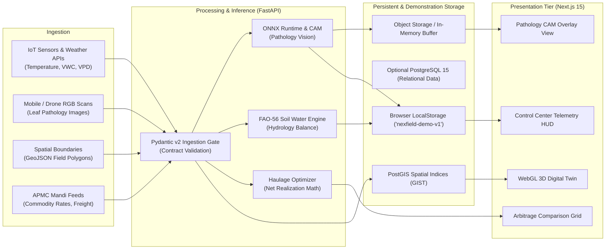
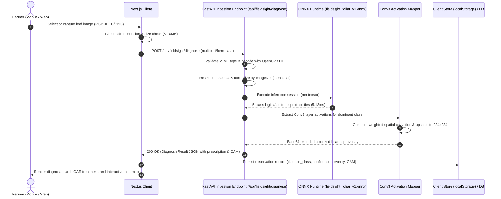
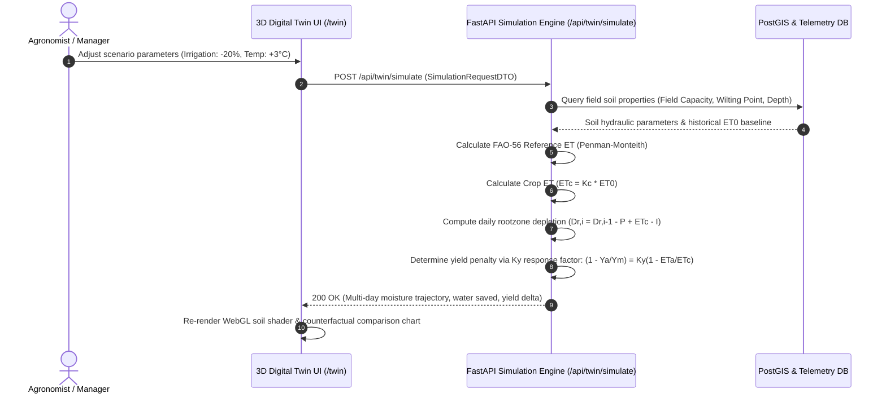
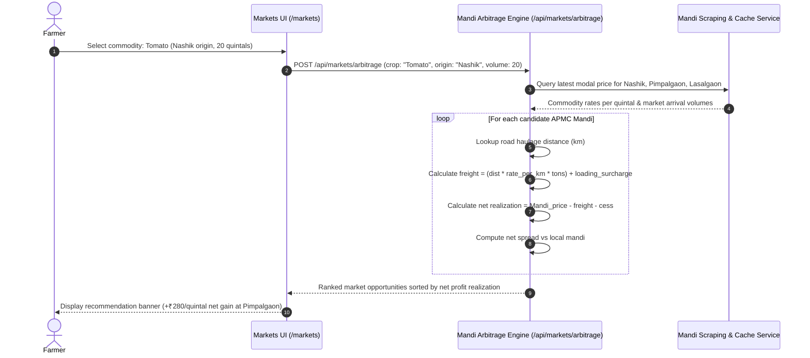

# NEXFIELD — Data Flow & Ingestion Lifecycle

**Project:** NEXFIELD — The Agricultural Intelligence Operating System  
**Hackathon:** ADAPPT 5.0 — Round 2 — Domain 2: AI in Food Technology  
**Version:** 2.4.0  
**Authors:** Tanish Bane (@TanishBane) & Rohan Panchal (@panchalrohan44)

---

## 1. End-to-End Data Pipeline Architecture

NEXFIELD processes multi-modal data streams across disparate agricultural domains: IoT soil microclimate sensors, high-resolution foliar RGB imagery, GIS spatial field polygons, and APMC market commodity rates.

---

## 2. Ingestion Lifecycles & Sequence Workflows

### 2.1 FieldSight Visual Pathology Workflow

### 2.2 Biophysical Twin Hydrology & Simulation Cycle

### 2.3 Mandi Market Freight Arbitrage Workflow

---

## 3. Spatial Polygon Handling & PostGIS Pipeline

1. **Polygon Boundary Ingestion:** Farm parcels are submitted as GeoJSON `Feature<Polygon>` structures containing coordinate rings in `EPSG:4326` (WGS 84).
2. **Topology & Validation:**
   - Shapely validates polygon closure, self-intersection, and orientation.
   - Rejects invalid polygons or degenerate geometries.
3. **Database Indexing:**
   - Stored in PostgreSQL using `GEOMETRY(Polygon, 4326)`.
   - Indexed via PostGIS R-Tree Spatial Index (`GIST (geometry_column)`), enabling sub-millisecond point-in-polygon queries and bounding box intersections.
4. **WebGL 3D Rendering Pipeline:**
   - Coordinates are normalized to local Cartesian coordinates $(X, Z)$ centered at the farm centroid.
   - Elevation data is sampled from digital elevation models (DEM) to produce three-dimensional terrain meshes.

---

## 4. Synthetic Fixture Fallback Protocol

When running in offline or local demonstration mode (`NEXT_PUBLIC_USE_FIXTURES=true`):
- All network adapters intercept API requests and serve pre-validated JSON fixtures from `data/fixtures/`.
- Every fixture payload includes the canonical metadata tag: `isFixture: true`.
- Guarantees 100% deterministic UI testing, instant load times, and reproducible evaluation without network reliance.

---

*Document maintained under NEXFIELD Data Systems.*
