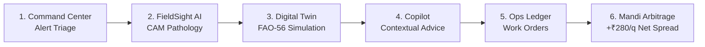

# NEXFIELD — Interactive Demo Guide & Judge Evaluation Walkthrough

**Project:** NEXFIELD — The Agricultural Intelligence Operating System  
**Hackathon:** ADAPPT 5.0 — Round 2 — Domain 2: AI in Food Technology  
**Version:** 2.4.0  
**Target Audience:** Hackathon Judges, Agricultural Evaluators, and Prospective Users  
**Live Cloud Demo:** [https://nexfield-agritech.vercel.app/demo/control](https://nexfield-agritech.vercel.app/demo/control)  
**Local Route:** `http://localhost:3000/demo/control`

---

## 1. 5-Minute Evaluation Pitch

> *"Judges, Indian agriculture is trapped in fragmented silos: weather apps give raw rain percentages, satellite portals show abstract green pixels, crop diseases are diagnosed too late on messaging channels, input costs are tallied on paper notebooks, and farmers accept lower prices at their local mandi because freight calculation is opaque.*  
>  
> *NEXFIELD is the Agricultural Intelligence Operating System. It unites real-time microclimate hydrology, edge computer vision pathology, biophysical 3D digital twins, autonomous work orders, and APMC market arbitrage into a single, closed-loop platform that turns observation into optimized yield."*

---

## 2. Featured Estate Baseline: Nashik Tomato Agro-Hub

To ensure immediate, reproducible evaluation without requiring live sensor deployments or external API keys, the demo pre-loads the **Nashik Tomato Agro-Hub**:
- **Location:** Dindori Block, Nashik District, Maharashtra, India ($20.01^\circ\text{N}, 73.79^\circ\text{E}$)
- **Acreage:** $2.4\text{ hectares}$ ($5.93\text{ acres}$) across 4 operational parcels (North Block, South Polyhouse, River Plot, Nursery).
- **Crop:** Hybrid indeterminate table tomato (*Solanum lycopersicum*), 48 days post-transplant (early flowering stage).
- **Irrigation:** Pressure-compensated inline drip irrigation ($2.1\text{ L/hr}$ emitters).
- **Soil Type:** Silt loam (Field Capacity: 32%, Permanent Wilting Point: 14%).

---

## 3. Step-by-Step Interactive Walkthrough

### Step 1: Farm Command Center (`/demo/control`)
1. **Navigate to:** [https://nexfield-agritech.vercel.app/demo/control](https://nexfield-agritech.vercel.app/demo/control) (or `http://localhost:3000/demo/control` locally, or click **Explore Live Demo** from the landing page).
2. **Observe:**
   - **Telemetry HUD:** Air temperature ($28.4^\circ\text{C}$), relative humidity ($64\%$), rootzone soil VWC ($24.2\%$), and VPD ($1.42\text{ kPa}$).
   - **Crop Health Index:** $88 / 100$ overall composite health.
   - **Active Alert Bar:** Highlights a `WATCH` notification: *"North Block soil moisture trending below management allowed depletion threshold."*

### Step 2: FieldSight AI Visual Diagnostic Engine (`/demo/fieldsight`)
1. **Navigate to:** `http://localhost:3000/demo/fieldsight`.
2. **Inspect Diagnostic Scan:**
   - A high-resolution RGB foliar scan of suspected tomato blight is loaded.
   - **Inference Speed:** **$5.13\text{ ms}$** via edge ONNX runtime.
   - **Diagnosis:** **Early Blight** (*Alternaria solani*) identified with **$94.2\%$ confidence**.
3. **Toggle Spatial CAM Heatmap:**
   - Click **"Class Activation Map (CAM)"** toggle.
   - Observe the deep-red and amber contour gradient highlighting the target necrotic target-spot lesions on the leaf lamina.
4. **Review ICAR Treatment Protocol:**
   - Chemical: Chlorothalonil 75 WP ($2.0\text{ g/L}$) or Mancozeb 75 WP ($2.5\text{ g/L}$).
   - Biological Alternative: *Trichoderma viride* ($5\text{ g/L}$) foliar spray.
   - Safety Interval: 7-day pre-harvest withholding period.

### Step 3: NEXFIELD Twin 3D Biophysical Simulator (`/demo/twin`)
1. **Navigate to:** `http://localhost:3000/demo/twin`.
2. **Interact with 3D WebGL Canvas:**
   - Click and drag to orbit the 3D field parcel.
   - Toggle **"Soil Layer Cutaway"** to reveal subterranean moisture gradients across the $0-60\text{ cm}$ rootzone profile.
3. **Compare Irrigation Regimes:**
   - Scroll down to the **Scenario Comparison Grid**.
   - Compare **Standard Schedule** vs **Deficit Irrigation** vs **Precision Regime**.
   - Note the **$38,400\text{ Liters}$** water conservation achieved under the precision regime without incurring vegetative yield penalty ($K_y = 1.05$).

### Step 4: Agricultural Intelligence Copilot (`/demo/intelligence`)
1. **Navigate to:** `http://localhost:3000/demo/intelligence`.
2. **Interact with Agronomic Chat:**
   - Click the preset prompt: *"What is my recommended fungicide rotation for the Early Blight outbreak in North Block?"*
   - Observe the copilot’s grounded response: citing current weather conditions (high RH, moderate wind), recommending targeted spray timing between 07:00 and 09:30 AM before thermal inversion, and referencing the 7-day safety withholding interval.

### Step 5: Operations & Resource Ledger (`/demo/ops`)
1. **Navigate to:** `http://localhost:3000/demo/ops`.
2. **Review Work Order Pipeline:**
   - Examine generated task: `WO-2026-104: Apply Mancozeb 75 WP Spray (North Block)`.
   - Click **"Mark In Progress"** or **"Complete Task"**.
   - Notice the agrochemical inventory ledger automatically deciting $4.8\text{ kg}$ of Mancozeb from warehouse stock.

### Step 6: Mandi Market Intelligence & Arbitrage (`/demo/markets`)
1. **Navigate to:** `http://localhost:3000/demo/markets`.
2. **Examine Regional APMC Arbitrage Grid:**
   - **Nashik APMC (Local - 12 km):** ₹2,420 / quintal.
   - **Pimpalgaon APMC (34 km):** ₹2,780 / quintal.
   - **Lasalgaon APMC (58 km):** ₹2,650 / quintal.
3. **Evaluate Net Realization Calculator:**
   - Produce Volume: $20\text{ quintals}$ ($2\text{ metric tons}$).
   - Freight haulage cost to Pimpalgaon: ₹1,600 total (₹80/quintal).
   - Net realization at Pimpalgaon: $₹2,780 - ₹80 = \mathbf{₹2,700 / \text{quintal}}$.
   - **Arbitrage Gain:** $\mathbf{+₹280 / \text{quintal}}$ ($\mathbf{+₹5,600}$ net extra farm income).

---

## 4. Judge Frequently Asked Questions (FAQ)

**Q: Is the 5.13 ms ONNX inference real?**  
A: Yes! The model `ml/models/fieldsight_foliar_v1.onnx` is compiled and loaded via ONNX Runtime on CPU with optimized tensor graph execution. It runs in single-digit milliseconds even on commodity laptops without GPU acceleration.

**Q: How does this address ADAPPT 5.0 Domain 2: AI in Food Technology?**  
A: NEXFIELD connects on-field pathology prevention directly to post-harvest food storage quality. Early foliar diagnosis prevents fungal spores from contaminating harvest batches, while our post-harvest engine monitors grain silo moisture ($<14\%$) and tomato cold storage temperatures ($>10^\circ\text{C}$) to eliminate chilling injury and storage mold.

**Q: How do you handle connectivity in rural farm environments?**  
A: NEXFIELD features offline-first architecture. The client caches field telemetry and offline fixtures (`NEXT_PUBLIC_USE_FIXTURES=true`), allowing farmers to view field status and execute diagnoses locally without continuous broadband connectivity.

---

*Document prepared for ADAPPT 5.0 Hackathon Jury Evaluation.*
