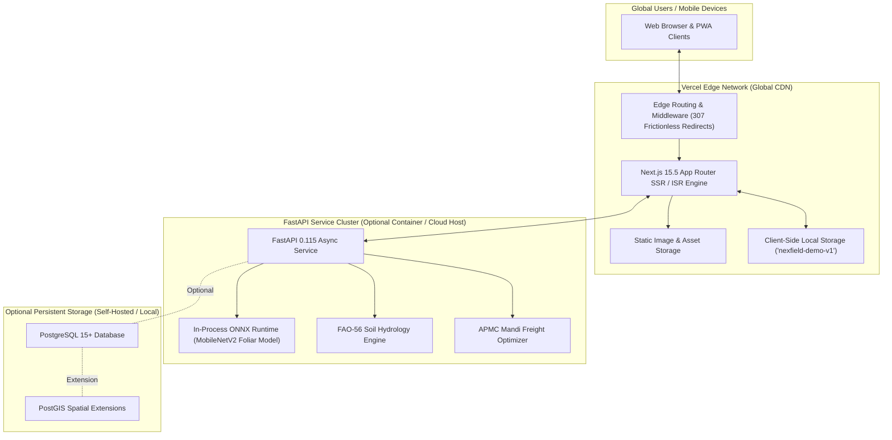
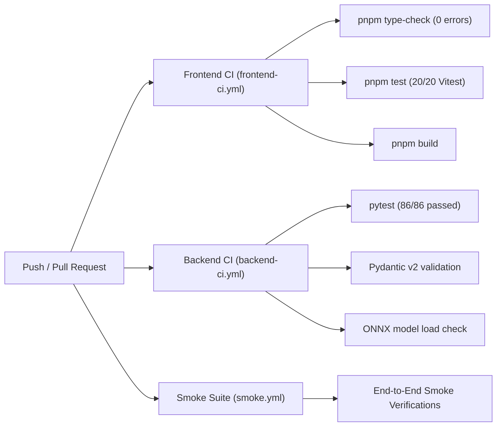

# NEXFIELD — Deployment, Cloud Architecture & Operations

**Project:** NEXFIELD — The Agricultural Intelligence Operating System  
**Hackathon:** ADAPPT 5.0 — Round 2 — Domain 2: AI in Food Technology  
**Version:** 2.5.0 (Public Demo Architecture)  
**Authors:** Tanish Bane (@TanishBane) & Rohan Panchal (@panchalrohan44)

---

## 1. Cloud Architecture Topology

NEXFIELD is designed for high-availability, zero-maintenance public demonstration deployment leveraging modern serverless edge primitives with optional self-hosted backend intelligence services:



---

## 2. Environment Variables Configuration Matrix

| Variable Name | Required In | Default / Example Value | Description |
|---|---|---|---|
| `NEXT_PUBLIC_APP_URL` | Web | `https://nexfield-agritech.vercel.app` | Canonical public application URL for redirects and metadata. |
| `NEXT_PUBLIC_APP_NAME` | Web | `NEXFIELD` | Brand name displayed across metadata and header. |
| `NEXT_PUBLIC_APP_ENV` | Web | `production` (Vercel) / `development` (Local) | Environment discriminator. |
| `NEXT_PUBLIC_USE_FIXTURES` | Web | `false` (API Priority) / `true` (Fixture Only) | Controls offline fallback to `data/fixtures/`. |
| `NEXT_PUBLIC_API_URL` | Web | `http://localhost:8000` | Optional backend FastAPI base URL for real-time ONNX inference and biophysical simulations. |
| `CORS_ORIGINS` | API (Backend) | `["http://localhost:3000","http://127.0.0.1:3000","https://nexfield-agritech.vercel.app"]` | Whitelisted origins permitted to execute cross-origin requests. |
| `DATABASE_URL` | API (Backend) | `postgresql+asyncpg://...` | Optional PostgreSQL connection string. Unset in public demo mode. |
| `MODEL_PATH` | API (Backend) | `ml/models/fieldsight_foliar_v1.onnx` | Path to compiled ONNX foliar diagnostic model. |
| `PORT` | API (Backend) | `8000` | FastAPI server listening port. |

---

## 3. Vercel Deployment Guide (Frontend)

- **Production Live URL:** [https://nexfield-agritech.vercel.app](https://nexfield-agritech.vercel.app)
- **Vercel Project:** `nexfield-agritech`
- **Root Directory:** `apps/web`

### Zero-Friction Public Demo Setup
The public demo deployed on Vercel runs completely out-of-the-box without requiring any cloud database configuration or authentication provider:

1. **Connect Repository:** Import `https://github.com/TanishBane/Nexfield` into Vercel Dashboard or link via CLI (`vercel link --yes --project nexfield-agritech`).
2. **Build & Development Settings:**
   - **Framework Preset:** `Next.js`
   - **Root Directory:** `apps/web` *(enables native Next.js detection while pnpm workspace resolves dependencies from monorepo packages)*
   - **Build Command:** `pnpm --filter @nexfield/contracts build && pnpm --filter @nexfield/ui build && next build`
   - **Output Directory:** Default (`.next`)
   - **Install Command:** `pnpm install`
   - **Node.js Version:** `22.x`
3. **Environment Variables:**
   - `NEXT_PUBLIC_APP_NAME="NEXFIELD"`
   - `NEXT_PUBLIC_APP_ENV="production"`
   - `NEXT_PUBLIC_USE_FIXTURES="true"` *(guarantees instantaneous domain-accurate agronomic responses across all 6 modules)*
4. **Deploy:** Run `vercel deploy --prod` or push to `main`. Vercel builds the Next.js App Router application and distributes it globally.

---

## 4. Optional Self-Hosted PostgreSQL / PostGIS Setup Guide

For developers running full backend persistence locally:

1. **Install PostgreSQL & PostGIS:** Ensure PostgreSQL 15+ with the PostGIS extension is installed.
2. **Enable Spatial Extensions:**
   ```sql
   CREATE EXTENSION IF NOT EXISTS postgis;
   ```
3. **Apply Database Migrations:**
   From your local development machine:
   ```powershell
   cd services/api
   alembic upgrade head
   ```
4. **Start FastAPI Backend:**
   ```powershell
   cd services/api
   py -m uvicorn main:app --reload --port 8000
   ```

---

## 5. Continuous Integration & Automation (GitHub Actions)

NEXFIELD executes automated CI workflows on every push and pull request to `main`:



### Workflow Summary:
- **`frontend-ci.yml`:** Checks out code, sets up Node.js 22 & pnpm, verifies zero TypeScript compiler errors across all packages, runs Vitest unit tests, and verifies successful static and server Next.js build.
- **`backend-ci.yml`:** Checks out code, sets up Python 3.11+, installs `services/api/requirements.txt`, executes all 86 pytest tests, and verifies contract conformance.
- **`dependabot.yml`:** Weekly security audits and automated dependency upgrade PRs for npm and pip packages.

---

*Document maintained under NEXFIELD DevOps & Cloud Operations.*
