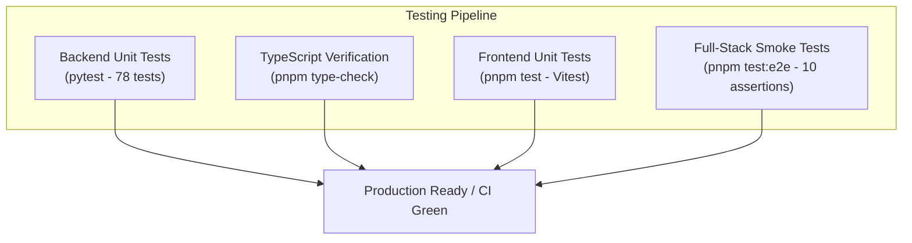

# NEXFIELD — Developer Experience & Engineering Workflow

**Project:** NEXFIELD — The Agricultural Intelligence Operating System
**Hackathon:** ADAPPT 5.0 — Round 2 — Domain 2: AI in Food Technology
**Version:** 2.4.0
**Authors:** Tanish Bane (@TanishBane) & Rohan Panchal (@panchalrohan44)

---

## 1. Monorepo Topology

NEXFIELD is structured as an integrated monorepo utilizing **pnpm workspaces** for TypeScript packages and an asynchronous Python virtual environment for backend API and ML operations:

```
c:\Nexfield\
├── apps/
│   └── web/                   # Next.js 15.5 App Router (Frontend Shell & WebGL Twin)
├── packages/
│   ├── contracts/             # Shared TypeScript Zod schemas & DTOs
│   └── ui/                    # Reusable APCA-compliant UI primitives & design tokens
├── services/
│   └── api/                   # FastAPI 0.115 backend & SQLAlchemy PostGIS models
│       ├── alembic/           # PostGIS database migrations
│       ├── app/               # FastAPI route handlers, dependencies, and business logic
│       └── tests/             # 78 comprehensive pytest unit and integration tests
├── ml/
│   ├── models/                # ONNX runtime models (fieldsight_foliar_v1.onnx)
│   └── model_cards/           # Model cards and evaluation benchmarks
├── data/
│   └── fixtures/              # Synthetic domain-accurate agronomic fixtures (isFixture: true)
├── docs/                      # Architectural deep dives, deployment guides, screenshots
├── scripts/                   # Automated smoke runners, screenshot capture, seeders
├── .github/workflows/         # CI/CD workflows (frontend-ci.yml, backend-ci.yml)
├── pnpm-workspace.yaml        # Workspace configuration
└── package.json               # Root scripts and dev dependencies
```

---

## 2. Prerequisites & Environment Setup

Ensure the following runtimes are installed on your workstation:
- **Node.js:** `v20.x` or `v22.x` LTS
- **pnpm:** `v9.x` (`corepack enable && corepack prepare pnpm@latest --activate`)
- **Python:** `3.11+` or `3.12+` / `3.14+` with pip
- **Git:** `2.40+`

---

## 3. Quick Start: Local Development

### 3.1 Windows (PowerShell)

```powershell
# 1. Clone repository & navigate to root
git clone https://github.com/TanishBane/Nexfield.git
cd Nexfield

# 2. Install monorepo dependencies
pnpm install

# 3. Setup Python virtual environment & backend dependencies
py -m venv .venv
.\.venv\Scripts\Activate.ps1
pip install -r services/api/requirements.txt

# 4. Configure local environment variables
Copy-Item apps/web/.env.example apps/web/.env.local
Copy-Item services/api/.env.example services/api/.env

# 5. Start the full-stack development environment concurrently
pnpm dev
```

### 3.2 macOS / Linux (Bash)

```bash
# 1. Clone repository & navigate to root
git clone https://github.com/TanishBane/Nexfield.git
cd Nexfield

# 2. Install monorepo dependencies
pnpm install

# 3. Setup Python virtual environment & backend dependencies
python3 -m venv .venv
source .venv/bin/activate
pip install -r services/api/requirements.txt

# 4. Configure local environment variables
cp apps/web/.env.example apps/web/.env.local
cp services/api/.env.example services/api/.env

# 5. Start the full-stack development environment concurrently
pnpm dev
```

---

## 4. Development Modes: Fixtures vs Live API

NEXFIELD supports two distinct operational modes:

### Mode A: Offline / Synthetic Fixture Mode (`NEXT_PUBLIC_USE_FIXTURES=true`)
- Default mode for rapid UI prototyping, offline demonstrations, and standalone evaluation without requiring live Supabase credentials.
- All telemetry, crop health metrics, work orders, and mandi prices are served from domain-accurate baseline datasets located in `data/fixtures/`.
- A persistent indicator is rendered in the UI banner: `"Development Mode: Synthetic Agronomic Fixtures"`.

### Mode B: Live Production SaaS Mode (`NEXT_PUBLIC_USE_FIXTURES=false`)
- Connects to live Supabase PostgreSQL + PostGIS database and FastAPI backend.
- Enforces strict user authentication, tenant isolation, and live database persistence.

---

## 5. Verification & Testing Suites

NEXFIELD maintains strict test-driven quality assurance across all layers:



### Command Reference:

| Target Subsystem | Execution Command | Test Scope & Assurances |
|---|---|---|
| **Backend Unit Tests** | `py -m pytest services/api/tests` | 78 tests covering auth claims, PostGIS queries, FAO-56 math, ONNX inference, and Mandi scraping. |
| **TypeScript Typecheck** | `pnpm type-check` | Enforces zero TypeScript errors across all workspaces and contract schemas. |
| **Frontend Unit Tests** | `pnpm test` | Vitest suites verifying component render states, formatters, and telemetry reducers. |
| **System Smoke Suite** | `pnpm test:e2e` | 10 end-to-end assertions verifying route availability, HTTP 200 responses, and contract integrity. |
| **Production Build** | `pnpm build` | Compiles optimized Next.js production bundles and static routes. |

---

## 6. Git Branching Strategy & Governance

In adherence to [`AGENTS.md`](file:///c:/Nexfield/AGENTS.md):

1. **Dedicated Ownership Branches:**
   - Frontend and UX enhancements: `feature/tanish-frontend` or dedicated task branches (`docs/`, `feat/`).
   - Backend and ML enhancements: `feature/z-backend`.
2. **Contract-First Changes:**
   - Any schema modifications to payloads or database columns must be proposed in `packages/contracts` and documented in `docs/contracts/API_SPECIFICATION.md` before implementation.
3. **Commit Conventions:**
   - Use semantic commit prefixes: `feat:`, `fix:`, `docs:`, `test:`, `refactor:`, `perf:`, `chore:`.
   - Never force-push (`git push --force`) to shared branches (`main`, long-lived feature branches).

---

*Document maintained under NEXFIELD Developer Experience.*
