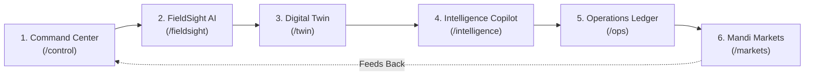

# NEXFIELD — Product Overview & Agronomic Intelligence Ecosystem

**Project:** NEXFIELD — The Agricultural Intelligence Operating System
**Hackathon:** ADAPPT 5.0 — Round 2 — Domain 2: AI in Food Technology
**Version:** 2.4.0
**Lead Developers:** Tanish Bane (@TanishBane) & Rohan Panchal (@panchalrohan44)

---

## 1. Executive Summary

NEXFIELD is an enterprise-grade Agricultural Intelligence Operating System engineered to address the systemic challenges of agricultural productivity, climate volatility, crop disease diagnosis, and post-harvest food waste. Developed specifically for **ADAPPT 5.0 Domain 2 (AI in Food Technology)**, NEXFIELD bridges the fragmented gap between raw field telemetry, biophysical science, deep learning vision, farm operations, and market realization.

Traditional agricultural software is disconnected: farmers check weather forecasts in consumer apps, view NDVI satellite maps on government portals, send leaf photos over messaging apps for informal advice, log input expenses on paper notebooks, and rely on local middleman pricing at the farm gate.

NEXFIELD replaces this fragmented workflow with a unified, continuous operational loop:
$$\text{Observe} \longrightarrow \text{Predict} \longrightarrow \text{Simulate} \longrightarrow \text{Optimize} \longrightarrow \text{Grow}$$

---

## 2. The Six Connected Operational Modules

### Module 1: NEXFIELD Control — Farm Command Center (`/control`)
- **Primary Function:** Continuous estate-wide situational awareness and active alert management.
- **Key Features:**
  - **Telemetry HUD:** Displays real-time microclimate metrics: ambient air temperature, relative humidity, vapor pressure deficit (VPD), rootzone soil volumetric water content (VWC), and leaf wetness duration.
  - **Crop Health Index (CHI):** A weighted composite score ($0-100$) reflecting vegetative vitality, soil moisture adequacy, and pathogen threat levels.
  - **Multi-Level Alert Triage:** Automatically classifies agronomic events into four prioritized urgency tiers:
    - `NORMAL`: All environmental parameters within optimal physiological envelopes.
    - `ADVISORY`: Emerging trends requiring monitoring (e.g., rising leaf wetness favoring fungal germination).
    - `WATCH`: Potential yield degradation without intervention (e.g., rootzone depletion exceeding 55%).
    - `EMERGENCY`: Immediate intervention required (e.g., severe Early Blight outbreak, severe heat stress).
  - **Quick Action Triggers:** One-click shortcuts to initiate diagnostic scans, launch counterfactual twin simulations, or dispatch labor crews.

### Module 2: FieldSight AI — Visual Foliar Pathology Engine (`/fieldsight`)
- **Primary Function:** Edge-optimized computer vision analysis of visible foliar diseases with spatial explainability.
- **Technical Pipeline:**
  1. High-resolution RGB foliar image ingestion via drag-and-drop or device camera.
  2. Input normalization ($224 \times 224 \times 3$ tensor, ImageNet mean $[0.485, 0.456, 0.406]$, std $[0.229, 0.224, 0.225]$).
  3. ONNX Runtime inference executing `fieldsight_foliar_v1.onnx` with $5.13\text{ ms}$ latency.
  4. Multi-class probability distribution output across 5 pathological classes:
     - *Early Blight* (*Alternaria solani*)
     - *Late Blight* (*Phytophthora infestans*)
     - *Septoria Leaf Spot* (*Septoria lycopersici*)
     - *Tomato Yellow Leaf Curl Virus* (Geminiviridae)
     - *Healthy Foliage*
  5. Spatial Class Activation Mapping (CAM) extracting Conv3 activation heatmaps, showing farmers the exact infected leaf lesions.
  6. Automated prescription generation adhering strictly to official Indian Council of Agricultural Research (ICAR) guidelines, including chemical dosage, biological biocontrol alternatives (*Trichoderma viride*), and mandatory pre-harvest withholding safety intervals.

### Module 3: NEXFIELD Twin — 3D Biophysical Simulator (`/twin`)
- **Primary Function:** Biophysically grounded rootzone hydrology and crop yield simulation using WebGL.
- **Scientific Foundation:**
  - Strict implementation of FAO-56 Penman-Monteith physics for Reference Evapotranspiration ($ET_o$) and Crop Evapotranspiration ($ET_c = K_c \times ET_o$).
  - Physical water conservation balance ($1\text{ mm} = 10\text{ m}^3/\text{ha}$).
  - Multi-layer soil hydraulic conductivity model tracking saturation, field capacity ($FC$), and permanent wilting point ($PWP$).
- **Scenario Simulator:**
  - Allows farmers to adjust counterfactual parameters: irrigation volume ($-30\%$ to $+50\%$), fertilizer dosage, and projected heatwave shocks.
  - Compares 4 standard operational regimes:
    1. *Standard Schedule:* Fixed timer-based irrigation without sensor feedback.
    2. *Deficit Irrigation:* Controlled stress during vegetative phase to conserve water.
    3. *Precision Regime:* Microclimate-timed pulses maintaining rootzone VWC within the optimal $28-34\%$ band.
    4. *Climate Shock Stress:* Simulated $+4^\circ\text{C}$ temperature anomaly with delayed irrigation.
  - Outputs predicted water savings, soil salinity risk, and estimated harvest yield impact ($K_y$ yield response factor).

### Module 4: NEXFIELD Intelligence — Agronomic Copilot (`/intelligence`)
- **Primary Function:** Multi-turn conversational agronomic advisor grounded in live farm context and extension guidelines.
- **Key Capabilities:**
  - Injects live farm telemetry (current soil VWC, active disease alerts, crop growth stage) into the system prompt context.
  - Provides scientifically cited agronomic guidance (ICAR, TNAU, PAU packages of practices).
  - Translates complex biophysical equations into clear, plain-language action plans for farm workers.
  - Supports quick-prompt shortcuts: *"Explain my irrigation plan"*, *"Recommend fungicide rotation"*, *"Evaluate harvest timing"*.

### Module 5: NEXFIELD Ops — Resource & Work Order Ledger (`/ops`)
- **Primary Function:** Operational dispatch, inventory control, and chain-of-custody tracking.
- **Core Features:**
  - **Work Order Management:** Dispatches actionable tasks directly from FieldSight diagnoses or Twin simulation recommendations.
  - **Labor Allocation:** Assigns work orders to farm technicians with priority levels, deadline timestamps, and completion checklists.
  - **Agrochemical & Fertilizer Inventory Ledger:** Automatically debits input stocks (e.g., Mancozeb 75 WP, Urea, Potassium Nitrate) upon task completion.
  - **Audit Trail:** Preserves an immutable historical log of all farm activities for organic or Good Agricultural Practices (GAP) certification.

### Module 6: NEXFIELD Markets — APMC Mandi Price Intelligence (`/markets`)
- **Primary Function:** Regional commodity price arbitrage and net-realization freight haulage calculation.
- **Key Capabilities:**
  - Real-time commodity spot rate tracking across regional APMC Mandis (e.g., Nashik, Pimpalgaon, Lasalgaon, Azadpur).
  - Historical modal price trends, 7-day moving averages, and arrival volume tracking.
  - **Freight Haulage Net Realization Calculator:**
    $$\text{Net Price Realization} = P_{\text{mandi}} - \text{Freight Cost per Quintal} - \text{Mandi Cess} - \text{Loading Surcharge}$$
  - Automatically identifies whether transporting produce to a distant higher-priced mandi yields a superior net profit after accounting for diesel, vehicle hire, and commodity shrinkage.

---

## 3. Food Technology & Post-Harvest Spoilage Engine (Domain 2 Focus)

Agricultural intelligence must not terminate at the field boundary. In food technology, up to 30% of harvested produce degrades due to improper post-harvest temperature management and moisture-driven microbial fungal contamination.

NEXFIELD includes an integrated Post-Harvest Food Quality Engine:

| Commodity | Critical Storage Parameter | Degradation Mechanism | NEXFIELD Protection Model |
|---|---|---|---|
| **Fresh Tomato** | Temperature $< 10^\circ\text{C}$ | Chilling injury causing surface pitting, mealiness, and failure to ripen (FAO Bulletin 149). | Alerts storage operator if cold room drops below $10^\circ\text{C}$ during green-mature storage stage. |
| **Durum / Bread Wheat** | Grain Moisture $> 14.0\%$ | *Aspergillus flavus* proliferation, mycotoxin contamination, grain heating. | Correlates silo moisture telemetry with equilibrium relative humidity (ERH) to trigger aeration fans. |
| **Paddy / Milled Rice** | Moisture Swing $> 2.5\%$ | Kernel fissuring, broken grain percentage increase during milling. | Evaluates drying rate hysteresis to prevent rapid moisture desorption. |

---

## 4. Primary User Personas & Value Proposition

### 1. Smallholder & Progressive Farmers
- **Pain Point:** Lack of access to certified plant pathologists and vulnerability to local mandi price exploitation.
- **NEXFIELD Impact:** Instant leaf disease diagnosis on mobile; clear transparency on whether traveling to a distant mandi earns more net income.

### 2. Commercial Farm & Estate Managers
- **Pain Point:** High input costs (water, electricity, expensive agrochemicals) and fragmented recordkeeping across hundreds of acres.
- **NEXFIELD Impact:** Up to 32% irrigation water conservation via precision scheduling; automated agrochemical inventory debits and work order dispatch.

### 3. Agricultural Extension Officers & Agronomists
- **Pain Point:** Inability to visit every farm parcel physically during peak disease season.
- **NEXFIELD Impact:** Remote digital twin telemetry monitoring, triaged alert queues, and verifiable visual pathology scans.

---

*Document maintained under NEXFIELD Product Engineering.*
