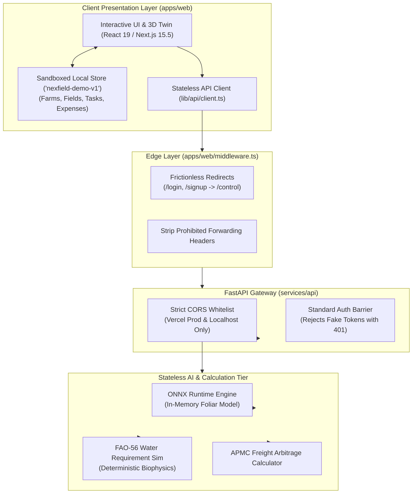

# NEXFIELD — Security Architecture, Demonstration Privacy & Compliance

**Project:** NEXFIELD — The Agricultural Intelligence Operating System  
**Hackathon:** ADAPPT 5.0 — Round 2 — Domain 2: AI in Food Technology  
**Version:** 2.5.0 (Public Demo Architecture)  
**Security Lead:** Tanish Bane (@TanishBane) & Rohan Panchal (@panchalrohan44)

---

## 1. Security Architecture Principles

NEXFIELD is engineered with defense-in-depth principles tailored for our open public demonstration platform and scalable agronomic intelligence services:

1. **Zero-Login Public Demo Architecture:** The public application requires no accounts, passwords, or cloud database credentials. Visitors immediately experience all six core modules without authentication friction.
2. **Client-Side State Sandboxing:** All user interactions—such as creating or modifying farms, fields, crop cycles, observations, ops work orders, and expenses—are isolated locally within the user's browser `localStorage` (`nexfield-demo-v1`). No cross-tenant data leakage or shared database pollution can occur.
3. **Stateless Public API Primitives:** Public inference and calculation endpoints (ONNX foliar disease diagnosis, FAO-56 rootzone hydrology simulation, Agmarknet mandi freight arbitrage) operate completely statelessly. They do not accept unauthenticated write requests to shared database tables.
4. **Decommissioned Authentication Bypasses:** Forgeable headers (`X-Demo-Mode: public-demonstration`) and static backdoor tokens (`demo-public-token`) are strictly prohibited and actively rejected with HTTP 401. Database-dependent endpoints enforce genuine authentication when deployed against a persistent database.
5. **Resilience Against Web Vulnerabilities:** Comprehensive protection against cross-site scripting (XSS), cross-origin abuse, and malicious file uploads.

---

## 2. Public Demonstration & Data Isolation Topology

---

## 3. Vulnerability Mitigations & Implementation Details

### 3.1 Strict Cross-Origin Resource Sharing (CORS) Isolation
The FastAPI backend strictly validates inbound origins against an explicit whitelist:
- `https://nexfield-agritech.vercel.app` (Official Vercel production deployment)
- `http://localhost:3000` (Local web development)
- `http://127.0.0.1:3000` (Local loopback development)

Wildcard (`*`) origins and unauthorized domains (e.g., `https://evil.com`) are explicitly disallowed. Inbound preflight `OPTIONS` requests from unauthorized origins receive no CORS allow headers.

### 3.2 Elimination of Insecure Demo Backdoors
Previous iterations utilized an `X-Demo-Mode: public-demonstration` request header and a hardcoded token `demo-public-token` to bypass database authentication. This design was audited and completely decommissioned:
- Inbound requests containing `X-Demo-Mode` or `demo-public-token` receive HTTP 401 `UNAUTHENTICATED`.
- Database-dependent routes (`/farms`, `/fields`, `/crop-cycles`, `/observations`, `/ops/tasks`) strictly enforce standard authentication (or HTTP 503 if a database engine is not configured).
- Public demonstration capabilities are fulfilled client-side via `useDemoStore` or through stateless mathematical/ONNX endpoints.

### 3.3 File Upload Security (FieldSight Visual Pathology)
To prevent remote code execution or storage exhaustion attacks via specimen image uploads:
- **Strict MIME Type Validation:** Only `image/jpeg`, `image/png`, and `image/webp` are accepted.
- **Size Limitation:** Payloads exceeding $10\text{ MB}$ are rejected with HTTP 413 Payload Too Large.
- **Image Sanitization:** Images are decoded and validated in-memory using PIL (Pillow) before tensor conversion, stripping any embedded malicious EXIF metadata, polyglot headers, or trailing payloads.
- **In-Memory Buffer Processing:** Uploaded images for diagnosis are processed entirely in memory without writing temporary files to server disks.

### 3.4 Next.js Middleware Hardening
- Route guards for deprecated authentication paths (`/login`, `/signup`, `/onboarding`) issue clean HTTP 307 temporary redirects to `/control` while preserving valid query parameters.
- Canonical URL normalization strips unauthorized proxy headers (`x-middleware-rewrite`, `x-middleware-override-headers`).

---

## 4. Secret Management & Zero-Leakage Policy

- **No Hardcoded Credentials:** Git history is continuously audited for secrets. API keys, JWT secrets, and database connection strings are never committed to the repository.
- **Template Hygiene:** Safe `.env.example` files are maintained in `apps/web/` and `services/api/` with synthetic placeholder values.
- **Zero Cloud Database Secrets on Frontend:** In the public demonstration architecture, frontend environment variables contain zero database credentials or administrative secrets.

---

## 5. Automated Security Audits & Continuous Scanning

- **Dependabot:** Configured via `.github/dependabot.yml` to run weekly vulnerability scans across npm and pip dependencies.
- **Static Analysis:** Pre-commit linting and TypeScript strict mode (`strict: true`, `noImplicitAny: true`) eliminate common JavaScript type-confusion and prototype pollution vulnerabilities.
- **Continuous Integration:** Automated GitHub Actions workflows verify that unit tests, type assertions, and security tests pass prior to merging.

---

*Document maintained under NEXFIELD Information Security.*
