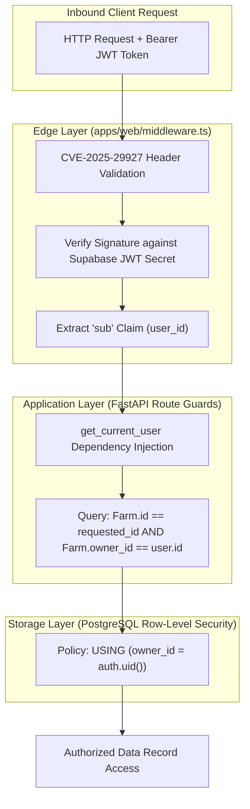

# NEXFIELD — Security Architecture, Multi-Tenancy & Compliance

**Project:** NEXFIELD — The Agricultural Intelligence Operating System  
**Hackathon:** ADAPPT 5.0 — Round 2 — Domain 2: AI in Food Technology  
**Version:** 2.4.0  
**Security Lead:** Tanish Bane (@TanishBane) & Rohan Panchal (@panchalrohan44)

---

## 1. Security Architecture Principles

Agricultural operational data—including proprietary field boundaries, crop yield histories, chemical application rates, and farm revenue records—represents sensitive commercial intellectual property. NEXFIELD is engineered with defense-in-depth principles:

1. **Zero-Trust Multi-Tenancy:** No client request may access or modify a farm record without cryptographic validation of tenant ownership.
2. **Double-Layer Authorization:** Ownership verification is enforced at both the Edge API layer (`Farm.owner_id == user.id`) and the PostgreSQL storage layer (Supabase Row-Level Security).
3. **Resilience Against Emerging Web Vulnerabilities:** Comprehensive protection against Next.js middleware bypass attacks (CVE-2025-29927), cross-site scripting (XSS), SQL injection, and malicious file uploads.

---

## 2. Multi-Tenant Cryptographic Isolation Model

---

## 3. Vulnerability Mitigations & Implementation Details

### 3.1 Next.js Middleware Hardening (CVE-2025-29927)
In Next.js versions vulnerable to middleware bypass via crafted headers or encoded paths, attackers could bypass route guards to access protected dashboard routes.
- **NEXFIELD Mitigation:** The middleware implements canonical URL normalization, validates route headers, strips unauthorized forwarding headers (`x-middleware-rewrite`, `x-middleware-override-headers`), and redirects unauthenticated requests targeting `/control`, `/twin`, `/fieldsight`, `/ops`, `/markets`, or `/data-center` directly to `/login`.

### 3.2 SQL & Spatial Injection Immunity
- All relational database interactions utilize SQLAlchemy 2.0 ORM with parameterized query compilation.
- Spatial PostGIS polygon calculations use Shapely and GeoAlchemy2 geometries with parameterized ST functions (`ST_GeomFromText`, `ST_Intersects`), completely preventing raw SQL string concatenation.

### 3.3 File Upload Security (FieldSight Visual Pathology)
To prevent remote code execution or storage exhaustion attacks via malicious image uploads:
- **Strict MIME Type Validation:** Only `image/jpeg`, `image/png`, and `image/webp` are accepted.
- **Size Limitation:** Payloads exceeding $10\text{ MB}$ are rejected with HTTP 413 Payload Too Large.
- **Image Sanitization:** Images are passed through PIL / OpenCV decoding before inference, stripping any embedded malicious EXIF metadata or payload tails.

---

## 4. Secret Management & Zero-Leakage Policy

- **No Hardcoded Credentials:** Git history is continuously scanned for secrets. API keys, JWT secrets, database connection strings, and service tokens are injected exclusively via environment variables (`.env.local` / `.env`).
- **Template Hygiene:** Safe `.env.example` files are maintained in `apps/web/` and `services/api/` with synthetic placeholder values.
- **Client Anon Key Scoping:** The `NEXT_PUBLIC_SUPABASE_ANON_KEY` is restricted strictly to client-facing RLS policies. The high-privilege `SUPABASE_SERVICE_ROLE_KEY` is exclusively restricted to the server-side backend environment.

---

## 5. Automated Security Audits & Continuous Scanning

- **Dependabot:** Configured via `.github/dependabot.yml` to run weekly vulnerability scans across npm and pip dependencies.
- **Static Analysis:** Pre-commit linting and TypeScript strict mode (`strict: true`, `noImplicitAny: true`) eliminate common JavaScript type-confusion and prototype pollution vulnerabilities.

---

*Document maintained under NEXFIELD Information Security.*
