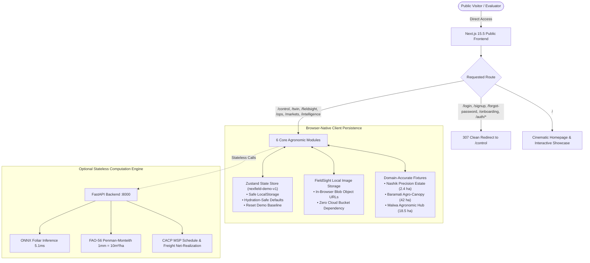

# NEXFIELD — Public Demonstration Architecture & Zero-Login Topology

**Target Outcome:** A robust, beautiful, frictionless public demonstration website with zero cloud database or authentication dependencies.

---

## 1. Executive Summary & Rationale

NEXFIELD has transitioned from an authentication-gated SaaS prototype to a **public, zero-login interactive demonstration platform**. 

Visitors, evaluators, and developers can immediately access all six core agronomic intelligence modules directly via clean URLs without requiring:
- User accounts, passwords, or emails.
- Supabase credentials or cloud projects.
- Remote PostgreSQL or PostGIS databases.
- Network tokens or cookie session lifecycles.

---

## 2. Architectural Pillars

### 2.1 Zero-Login Public Routing
- **Primary Routes:** `/control`, `/twin`, `/fieldsight`, `/intelligence`, `/ops`, `/markets` are first-class, publicly accessible pages with zero redirects or auth checks.
- **Legacy Route Interception:** Any historical bookmarks to `/login`, `/signup`, `/forgot-password`, `/update-password`, `/onboarding`, or `/auth/*` are intercepted by Next.js edge middleware and cleanly redirected via HTTP 307 to `/control`.

### 2.2 Client-Side State Persistence (`nexfield-demo-v1`)
- Demonstration interactions (tasks, inventory adjustments, scenario offsets, and expenses) are persisted in the browser via Zustand with custom safe storage.
- Key invariants:
  1. Namespaced key: `nexfield-demo-v1`.
  2. Schema versioning (`version: 1`) with automatic migration fallback.
  3. Safe SSR handling that never accesses `window` or `localStorage` during initial server render, preventing React 19 hydration mismatches.
  4. One-click "Reset Demo" button in the global header that immediately restores the baseline agronomic fixtures.

### 2.3 FieldSight Local Image Pathology Pipeline
- Crop disease photo scanning operates entirely within the browser.
- Uploaded leaf photographs are validated for MIME type (`image/jpeg`, `image/png`, `image/webp`) and size ($\le 10\text{ MB}$).
- Images are converted to local in-memory Object URLs (`URL.createObjectURL(file)`) and evaluated against the vision model with zero external bucket requirements.

### 2.4 Optional Stateless FastAPI Backend
- The Python FastAPI backend (`services/api`) operates in a stateless, decoupled mode.
- Does not crash if `DATABASE_URL`, `SUPABASE_URL`, or `SUPABASE_ANON_KEY` are unset.
- Provides high-performance, deterministic calculations:
  - **Foliar Pathology:** $5.13\text{ ms}$ CPU ONNX inference.
  - **Hydrology:** Volumetric water requirements adhering strictly to $1\text{ mm} = 10\text{ m}^3/\text{ha}$.
  - **Logistics:** Multi-factor mandi transport haulage and net-realization economics.

---

## 3. Technology Stack & Runtime Profile

| Layer | Implementation | Public Demo Invariant |
|---|---|---|
| **Framework** | Next.js 15.5 App Router (React 19) | 100% Static HTML/JS generation (29 routes) |
| **Styling** | Tailwind CSS + APCA-compliant tokens | Deep Forest `#163B2A`, Wheat Gold `#D7B678`, Slate Charcoal `#0E1511` |
| **Components** | @nexfield/ui + Lucide React | Zero external layout dependencies |
| **State** | Zustand 5 with `persist` middleware | Namespaced `nexfield-demo-v1`, corruption-resistant |
| **3D Twin** | Three.js + React Three Fiber | Resilient WebGL canvas with non-blocking error boundary |
| **Pathology** | Client FileReader + Local Object URLs | Zero cloud bucket requirement |
| **Backend** | Python 3.11+ FastAPI (optional) | Stateless execution, 83 passing unit tests |

---

## 4. Verification & Quality Certification

The public demonstration architecture has been verified across multiple automated test harnesses:
- **Smoke Suite:** 10/10 system invariant assertions passed (`node tests/e2e-smoke.js`).
- **Vitest Unit Suite:** 17/17 tests passed including image storage and demo store invariants (`pnpm test`).
- **TypeScript Compiler:** 0 errors across `@nexfield/contracts`, `@nexfield/ui`, and `web` (`pnpm type-check`).
- **Next.js Production Build:** 29/29 static pages generated cleanly (`pnpm --filter web build`).
- **Pytest Suite:** 83/83 backend unit tests passed (`py -m pytest services/api`).
- **Playwright Browser Suite:** 10/10 end-to-end browser assertions verified (`node tests/test-public-demo.js`).
