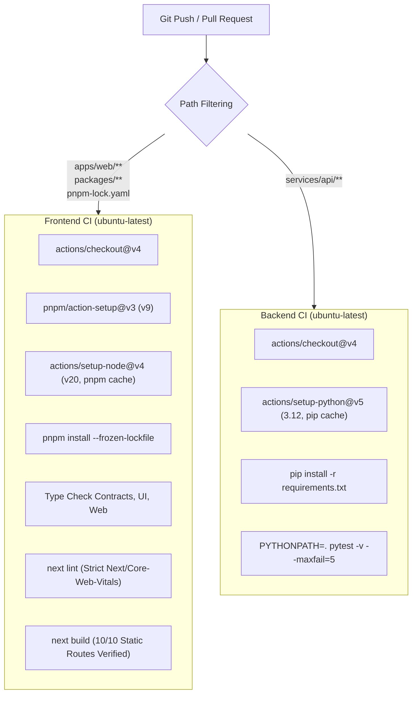

# NEXFIELD — Continuous Integration & GitHub Actions Architecture

**Document Purpose:** Architectural documentation of the continuous integration pipelines guarding the NEXFIELD repository across the Next.js frontend, shared contracts, and FastAPI backend services.

---

## 1. CI Pipeline Architecture

NEXFIELD enforces two independent, decoupled workflows to avoid cross-domain blocking:



---

## 2. Workflows Overview

### A. Frontend CI ([`.github/workflows/frontend-ci.yml`](file:///C:/Nexfield/.github/workflows/frontend-ci.yml))
- **Triggers:** Push to `main` and Pull Requests targeting `main` affecting `apps/web/**`, `packages/**`, `data/fixtures/**`, or `pnpm-lock.yaml`.
- **Concurrency Control:**
  ```yaml
  concurrency:
    group: ${{ github.workflow }}-${{ github.ref }}
    cancel-in-progress: ${{ github.ref != 'refs/heads/main' }}
  ```
  Cancels outdated runs on feature branches upon subsequent pushes, preserving GitHub Actions runner quotas.
- **Security Permissions:**
  ```yaml
  permissions:
    contents: read
  ```
  Strict read-only permissions preventing token compromise.
- **Verification Gates:**
  1. `pnpm install --frozen-lockfile`: Guarantees lockfile integrity and rejects undeclared dependencies.
  2. `pnpm --filter @nexfield/contracts type-check`: Validates shared Zod contracts and DTOs.
  3. `pnpm --filter @nexfield/ui type-check`: Validates design system primitives.
  4. `pnpm --filter web type-check`: Validates App Router components.
  5. `pnpm --filter web lint`: Enforces zero ESLint warnings/errors.
  6. `pnpm --filter web build`: Builds optimized production bundles across all static pages.

### B. Backend CI ([`.github/workflows/backend-ci.yml`](file:///C:/Nexfield/.github/workflows/backend-ci.yml))
- **Triggers:** Push to `main` and Pull Requests targeting `main` affecting `services/api/**`.
- **Execution Directory:** `services/api`
- **Environment:** Python 3.12 with pip cache.
- **Verification Gates:**
  1. Automated installation of backend dependencies (`fastapi`, `pydantic`, `pytest`, `pytest-asyncio`, `respx`, etc.).
  2. Test execution: `PYTHONPATH=. pytest -v --maxfail=5`. Setting `PYTHONPATH=.` guarantees that imports from `main.py` and `app/` resolve reliably regardless of runner subshell configuration.

---

## 3. Recommended Branch Protection Rules for `main`

To maintain production stability on `main`:
1. **Require a pull request before merging:**
   - Require at least 1 approving review from the respective directory owner (Developer Tanish for frontend, Developer Rohan for backend).
   - Dismiss stale pull request approvals when new commits are pushed.
2. **Require status checks to pass before merging:**
   - `verify-frontend` (from `Frontend CI`)
   - `test-backend` (from `Backend CI`)
3. **Require branches to be up to date before merging.**
4. **Prevent force pushes (`--force`).**
5. **Prevent branch deletions.**
