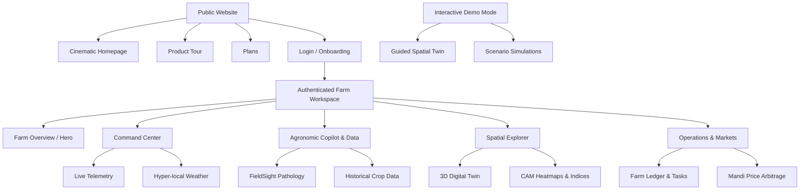

# NEXFIELD Navigation Blueprint & Information Architecture

## 1. Core Philosophy: Progressive Disclosure

The current application structure presents a flat array of powerful tools. The cinematic redesign introduces a dramatically simplified navigation system built on progressive disclosure.

We separate the application into three distinct experiential zones:
1. **Public/Marketing:** A cinematic, scrolling narrative explaining the platform.
2. **Interactive Demo Mode:** A guided, safe-environment exploration of features using synthetic fixtures.
3. **Authenticated Workspace:** The dense, operational environment for actual farm management.

## 2. Route Hierarchy Diagram

## 3. Navigation UI Strategy

To achieve the "Cinematic, sophisticated, and minimal" objective:

### Desktop Experience: Floating Contextual Sidebar
- Abandon the traditional, heavy top-navigation bar.
- Introduce a minimal, floating left-hand sidebar containing only icons for the primary pillars (Overview, Control, Intelligence, Spatial, Execution) to maximize screen real estate for the 3D Twin and large data visualizations.
- Hovering or clicking expands a secondary drawer for sub-navigation.

### Mobile Experience: Action-Oriented Bottom Bar
- Complex SaaS tools degrade on mobile. NEXFIELD will utilize a native-feeling bottom navigation bar.
- The bottom bar contains: Home, Twin, FieldSight, and Menu (which opens a full-screen modal for deeper links).
- Floating Action Buttons (FABs) will be used for primary actions within contexts (e.g., "Scan Crop" in FieldSight).

### The "Cinematic Hero" Overview
- Upon login, the user does not immediately see dense tables.
- They see a "Cinematic Hero" page: A beautifully rendered high-level summary of the farm's status, overlaid on a blurred or stylized representation of their Digital Twin, with large, editorial typography highlighting the most critical current metric (e.g., "Harvest ready in 3 days").

## 4. Subpage Functional Definitions

- **Control (Command Center):** The operational heartbeat. Real-time dials, tabular-num telemetry, and immediate alerts (e.g., Post-Harvest Spoilage risk).
- **FieldSight:** An image-inspection workspace. Large image viewer, clinical overlay of disease confidence, and ICAR prescription cards.
- **Twin:** The spatial explorer. Full-bleed WebGL canvas with floating scenario controllers (e.g., toggling irrigation layers).
- **Intelligence (Farm Data):** Dense, analytical views. ECharts integrations showing historical yield trajectories.
- **Ops:** Task management, inventory tracking, and ledger. Standardized list/card views.
- **Markets:** Split-pane or comparative layouts showing current inventory vs. live AGMARKNET Mandi prices.
