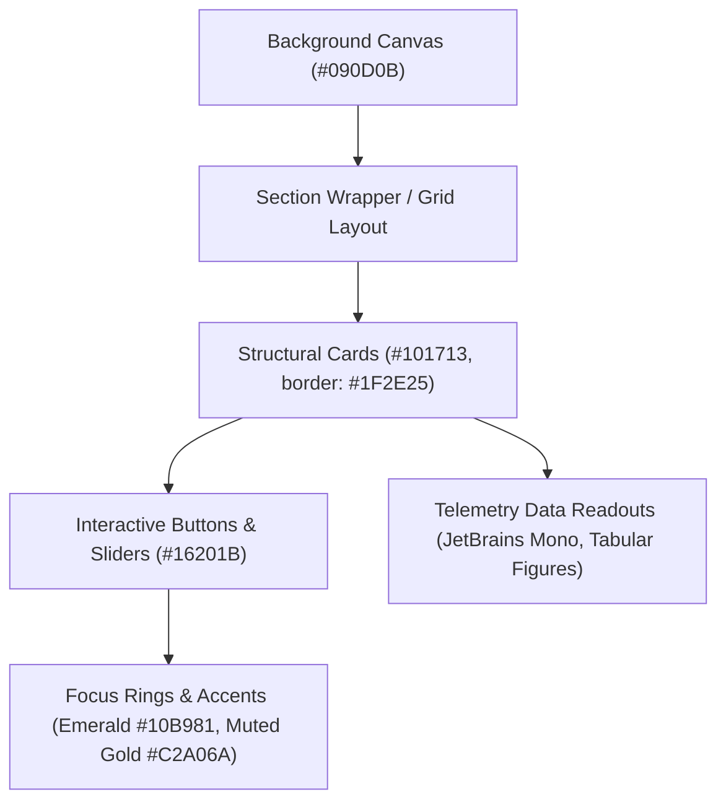

# CINEMATIC DESIGN SYSTEM — PROJECT EARTH

**Project:** NEXFIELD — The Agricultural Intelligence Operating System  
**Lead Designer & Architect:** Tanish Bane (@TanishBane)  
**Hackathon:** ADAPPT 5.0 — Round 2 — Domain 2: AI in Food Technology  
**Version:** 2.0.0 (Project Earth Edition)  
**Status:** Canonical & Active

---

## 1. Philosophical Foundations & Visual World

NEXFIELD rejects the generic "neon cyberpunk dashboard" aesthetic in favor of **Project Earth**: an editorial, cinematic, deeply grounded design system inspired by the tactile realities of biological agriculture, satellite remote sensing, and soil hydrology.

### Design Principles:
1. **The Dark Earth World:**
   Fields at night, deep humus, rich topsoil, and illuminated satellite telemetry. The background is not harsh pitch-black (`#000000`) nor generic slate gray (`#1E293B`); it is organic obsidian and deep charcoal infused with chlorophyll green undertones.
2. **Editorial Gravitas Meets Technical Precision:**
   Display typography conveys authoritative agricultural literature and agronomic heritage, while monospace numerals provide mathematical certainty for soil water matrix potentials, foliar confidence levels, and mandi rupee spreads.
3. **Restrained Ambient Illumination:**
   Glows are calibrated and localized like morning mist or bioluminescent soil sensors, never blinding neon flares or random floating confetti.
4. **Calm, Decisive Information Density:**
   Progressive disclosure ensures that executive summaries are immediately legible from across the room, while five deep sub-layers of soil chemistry and leaf pathology are one click away.

---

## 2. Canonical Color Palette & Token Architecture

All tokens are formalized in `packages/ui/src/tokens.ts` and mirrored in `apps/web/tailwind.config.ts`.

| Token Name | Hex Code | Semantic Role | APCA / WCAG Role |
|---|---|---|---|
| `obsidian` / `background` | `#090D0B` | Deepest canvas background | Foundation background layer |
| `card` / `deepCharcoal` | `#101713` | Elevated card & container surface | Card background (Lcr 75+ against text) |
| `cardHover` / `darkSurface` | `#16201B` | Hover states, active tabs | Interactive card hover surface |
| `border` / `soilBorder` | `#1F2E25` | Primary divider & structural border | Subtle container boundaries |
| `borderHover` / `borderAccent` | `#273C30` | Focused & hovered border | Visual focus ring anchor |
| `forestGreen` | `#173C2C` | Deep vegetative anchor | Foliar framing & section headers |
| `emeraldCore` | `#10B981` | Brand identity & optimal health | High-priority interactive accents |
| `emeraldBright` | `#34D399` | Critical action pills & pulses | Visual status indicators |
| `warmIvory` / `warmWhite` | `#FAF8F2` | Primary headlines & display copy | Maximum contrast readable text |
| `softSage` | `#9BB1A4` | Secondary interface text | Body paragraphs & labels |
| `mutedGold` | `#C2A06A` | Harvest, wheat, market accents | Editorial italic display accents |
| `vadoseSky` | `#38BDF8` | Infiltration, soil moisture, water | Hydrological & vadose indicators |
| `foliarBlight` | `#F43F5E` | Disease pathology & critical risks | Phytopathology alerts |

### Strict Token Invariants:
- **No Arbitrary Hex Values:** Component styles must strictly utilize design system tokens (`tokens.ts`) or Tailwind utility aliases (`earth-*`).
- **Surface Elevation Contrast:** Each card layer must have at least a 6% lightness step from its parent surface (`#090D0B` -> `#101713` -> `#16201B`).

---

## 3. Geometric & Spatial Rules

### The Nested Radii Invariant:
To maintain optical harmony, child corner radii must never exceed parent corner radii minus internal padding:

$$r_{\text{child}} \le r_{\text{parent}} - p_{\text{internal}}$$

- Top-level modal / viewport sheet: `rounded-3xl` (24px) with `p-6` (24px padding).
- Inner cards: `rounded-2xl` (16px) with `p-4` (16px padding).
- Embedded badges / buttons: `rounded-xl` (12px) or `rounded-lg` (8px).

### Spacing & Grid System:
- **Vertical Rhythm:** Multiples of 4px / 8px grid (`gap-4`, `gap-6`, `gap-8`, `gap-16`).
- **Responsive Layout Shell:**
  - Public Marketing: Max width `max-w-7xl mx-auto px-4 sm:px-6 lg:px-8`.
  - Workspace Command Center: Full-bleed fluid container with constrained max-width `max-w-7xl` to prevent ultra-wide visual fragmentation.

---

## 4. APCA & WCAG Accessibility Invariants

1. **Text Contrast:**
   - Primary text (`#FAF8F2` on `#090D0B`) achieves an APCA contrast score of **$L_c \approx 104$** (exceeding bronze, silver, and gold criteria for body text).
   - Secondary text (`#9BB1A4` on `#101713`) achieves $L_c \approx 72$, well above the threshold for 14px text.
   - Tertiary metadata (`#63796E` on `#101713`) is restricted to uppercase monospace identifiers $\ge 11\text{px}$.
2. **Keyboard Traversal & Focus Indicators:**
   - Every interactive control exposes an accessible `:focus-visible` outline using `ring-2 ring-emerald-500/60 ring-offset-2 ring-offset-[#090D0B]`.
   - Global command palette accessible via both `Ctrl+K` (Windows/Linux) and `Cmd+K` (macOS).
3. **Reduced Motion:**
   - All GSAP scroll animations and CSS pulsing keyframes conditionally evaluate `window.matchMedia('(prefers-reduced-motion: reduce)')`.

---

## 5. Component Hierarchy & Elevation Levels

