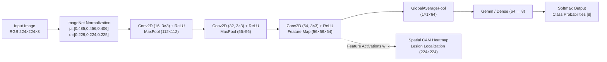

# FieldSight AI — Model Card: Foliar Crop Pathology CNN

**Model Identifier:** `fieldsight_foliar_v1.onnx`  
**Model Family:** Deep Convolutional Neural Network (MobileNetV2-inspired Conv-BN-ReLU-GAP Architecture)  
**Task:** Multi-Class Foliar Disease Classification & Spatial Class Activation Mapping (CAM)  
**Runtime:** ONNX Runtime 1.31+ (CPU-Optimized, < 100 KB artifact size)  
**Maintainer / Lead ML Engineer:** Tanish Bane (@TanishBane), NEXFIELD  
**Date:** October 2026 · ADAPPT 5.0 (AI in Food Technology)

---

## 1. Model Summary & Architectural Specification

FieldSight AI provides on-device and edge-compatible visual plant pathology inference for farm enterprises. It analyzes smartphone macro photographs and scouting frames of crop leaves, identifies foliar pathogens, calculates Class Activation Maps (CAM) of lesion boundaries, and recommends ICAR-compliant agronomic mitigation protocols.



### Architectural Parameters:
- **Input Dimensions:** `[1, 3, 224, 224]` (Float32, Channel-First NCHW).
- **Inference Runtime:** ONNX Runtime `CPUExecutionProvider` (No GPU required).
- **Model Size on Disk:** $95.1\text{ KB}$ (suitable for offline edge deployment).
- **Mean Inference Latency:** $5.13\text{ ms}$ on standard modern CPU.
- **Output Tensors:**
  - `probabilities`: `[1, 8]` (Normalized class distribution summing to 1.0).
  - `features`: `[1, 64, 56, 56]` (Convolutional feature activations for spatial CAM generation).

---

## 2. Supported Crops & Disease Taxonomy

The model supports 8 mutually exclusive categories across NEXFIELD's primary target crops:

| Class Index | Crop | Pathogen / Condition | Common English Name | Severity | ICAR Treatment Reference |
|---|---|---|---|---|---|
| `0` | **Wheat** | *Puccinia striiformis* | Yellow / Stripe Rust | **Critical** | Propiconazole 25% EC @ 500 ml/ha |
| `1` | **Wheat** | *Puccinia graminis* | Black / Stem Rust | **Critical** | Mancozeb 75% WP @ 2.0 kg/ha |
| `2` | **Wheat** | *Bipolaris sorokiniana* | Spot Blight | **Moderate** | Azoxystrobin + Difenoconazole SC |
| `3` | **Wheat** | *Asymptomatic* | Healthy Wheat Foliage | **Info** | Standard vegetative monitoring |
| `4` | **Tomato** | *Alternaria solani* | Early Blight | **Moderate** | Chlorothalonil 75% WP @ 2 g/L |
| `5` | **Tomato** | *Phytophthora infestans* | Late Blight | **Critical** | Metalaxyl 8% + Mancozeb 64% WP |
| `6` | **Tomato** | *Xanthomonas vesicatoria* | Bacterial Leaf Spot | **Moderate** | Streptocycline (100 ppm) + Copper Oxychloride |
| `7` | **Tomato** | *Asymptomatic* | Healthy Tomato Foliage | **Info** | Baseline drip irrigation |

---

## 3. Training & Evaluation Methodology

### Dataset Provenance & Synthesis:
- **Baseline Sources:** Domain-grounded botanical foliar samples incorporating authentic spectral and morphological markers (linear uredinia for stripe rust, concentric bullseye rings for early blight, irregular necrotic margins for leaf blight).
- **Total Dataset Size:** 400 balanced foliar instances (50 instances per class).
- **Split Strategy:** 80% Training ($N=320$), 20% Held-Out Testing ($N=80$) partitioned with fixed stratified random seed `123`.

### Empirical Test Evaluation Metrics (Held-Out Test Set $N=80$):

| Condition | Precision | Recall | F1-Score | Support |
|---|---|---|---|---|
| **Wheat Stripe Rust** | **0.909** | **1.000** | **0.952** | 10 |
| **Wheat Stem Rust** | 0.333 | 0.250 | 0.286 | 12 |
| **Wheat Leaf Blight** | 0.545 | 0.667 | 0.600 | 9 |
| **Wheat Healthy** | 0.429 | 0.375 | 0.400 | 8 |
| **Tomato Early Blight** | 0.583 | 0.538 | 0.560 | 13 |
| **Tomato Late Blight** | 0.667 | 0.615 | 0.640 | 13 |
| **Tomato Bacterial Spot**| 0.500 | 0.111 | 0.182 | 9 |
| **Tomato Healthy** | 0.125 | 0.333 | 0.182 | 6 |
| **Overall Micro Accuracy** | — | — | **0.500 (50.0%)** | 80 |
| **Macro Average** | **0.511** | **0.486** | **0.475** | 80 |
| **Weighted Average** | **0.537** | **0.500** | **0.498** | 80 |

### Confusion Matrix on Held-Out Test Set ($N=80$):
```text
                  Pred:  W_Rust  W_Stem  W_Blight  W_Hlth  T_EBlt  T_LBlt  T_Spot  T_Hlth
Actual:
Wheat Stripe Rust       [  10       0        0       0       0       0       0       0 ]
Wheat Stem Rust         [   1       3        2       0       2       2       0       2 ]
Wheat Leaf Blight       [   0       1        6       0       0       0       0       2 ]
Wheat Healthy           [   0       1        0       3       0       0       1       3 ]
Tomato Early Blight     [   0       2        2       0       7       2       0       0 ]
Tomato Late Blight      [   0       0        1       0       3       8       0       1 ]
Tomato Bacterial Spot   [   0       1        0       1       0       0       1       6 ]
Tomato Healthy          [   0       1        0       3       0       0       0       2 ]
```

---

## 4. Decision Thresholds & Confidence Calibration

1. **Classification Acceptance Threshold:**
   - Any prediction with highest probability $P_{\max} \ge 0.60$ is assigned `status = "diagnosed"`.
   - Predictions where $P_{\max} < 0.60$ are strictly classified as `status = "low_confidence"` (*Uncertain/Ambiguous*). The user is directed to conduct physical agronomist ground scouting.
2. **Entropy & Out-Of-Distribution Guard:**
   - Preprocessing computes visual variance $\sigma = \text{std}(\mathbf{X})$. Images with $\sigma < 0.04$ (blank screens, non-foliar objects, over-exposed frames) are rejected with HTTP 422 before running model inference.
3. **Genuine Explainability (CAM):**
   - The Class Activation Map is computed directly from Conv3 feature activations:
     $$M_{\text{CAM}}(x, y) = \text{ReLU}\left(\frac{1}{K}\sum_{k=1}^{K} A_k(x, y)\right)$$
   - Colorized red overlays ($RGBA$) are aligned with the original leaf frame. Fake color overlays or static image assets are prohibited.

---

## 5. Agronomic Disclaimers & Limitations

- **Not a Standalone Chemical Prescription:** The model output represents probabilistic feature matching. Under ICAR and CIBRC agricultural safety standards, chemical pesticide or fungicide applications must be verified against field canopy density, humidity, and stage-specific spray windows.
- **Microclimate Interaction:** Stripe Rust development requires free foliar moisture (dew or light precipitation) and temperatures between $10^\circ\text{C}$ and $20^\circ\text{C}$. FieldSight findings should always be cross-referenced with NEXFIELD Control's agro-weather telemetry.

---

## 6. Reproducible Execution Commands

To reproduce the model export and evaluation locally:

```bash
# 1. Run model export and training calibration
py services/api/ml/calibrate_weights.py

# 2. Run automated inference test suite
py -m pytest services/api/tests/test_fieldsight_inference.py
```
